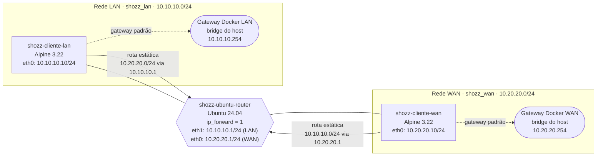

# Shozz Infra Lab — Laboratório de Roteamento LAN/WAN com Docker

> Projeto acadêmico de **Segurança da Informação**, com um laboratório autorizado pelo professor da disciplina.
> Este documento trata da **infraestrutura de rede**. As demais frentes do trabalho (SSH seguro, hardening, firewall e integridade) estão indicadas como etapas futuras ou responsabilidade de outros integrantes.

---

## Sumário

1. [Descrição e objetivo](#1-descrição-e-objetivo)
2. [Contextualização do laboratório](#2-contextualização-do-laboratório)
3. [Tecnologias utilizadas](#3-tecnologias-utilizadas)
4. [Arquitetura da infraestrutura](#4-arquitetura-da-infraestrutura)
5. [Diagrama da topologia](#5-diagrama-da-topologia)
6. [Tabela de endereçamento IP](#6-tabela-de-endereçamento-ip)
7. [Os três contêineres](#7-os-três-contêineres)
8. [Configuração das redes Docker](#8-configuração-das-redes-docker)
9. [Funcionamento do roteador Ubuntu](#9-funcionamento-do-roteador-ubuntu)
10. [Encaminhamento IPv4](#10-encaminhamento-ipv4)
11. [Rotas: diretamente conectadas, estáticas e gateway padrão](#11-rotas-diretamente-conectadas-estáticas-e-gateway-padrão)
12. [Procedimentos de inicialização](#12-procedimentos-de-inicialização)
13. [Comandos úteis de administração](#13-comandos-úteis-de-administração)
14. [Testes executados](#14-testes-executados)
15. [Resultados reais dos testes](#15-resultados-reais-dos-testes)
16. [Evidências](#16-evidências)
17. [Limitações e considerações técnicas](#17-limitações-e-considerações-técnicas)
18. [Etapas futuras do projeto](#18-etapas-futuras-do-projeto)
19. [Conclusão](#19-conclusão)

---

## 1. Descrição e objetivo

O **Shozz Infra Lab** simula, com contêineres Docker, uma pequena infraestrutura com **duas sub-redes IPv4 interligadas por um roteador Linux (Ubuntu 24.04)**.

Objetivos desta etapa:

- montar uma topologia LAN/WAN com duas sub-redes separadas, fácil de reproduzir;
- configurar um host Ubuntu para funcionar como **roteador**, com uma interface em cada sub-rede e encaminhamento IPv4 ativo;
- configurar clientes que só alcançam a rede oposta **através do roteador**;
- **comprovar com testes reais** que o tráfego entre as sub-redes atravessa o roteador;
- servir de base para as próximas etapas: SSH seguro, hardening do Ubuntu, firewall e integridade de arquivos.

## 2. Contextualização do laboratório

Em redes reais, um roteador interliga segmentos diferentes. Por exemplo, uma rede interna (LAN) e uma rede externa (WAN). Ele é o ponto natural para aplicar controles de segurança, como acesso administrativo restrito, filtragem de pacotes e registro de eventos. Por isso, o primeiro passo do trabalho é ter um roteador funcional e verificável, que depois será protegido.

O ambiente roda **inteiramente em uma única máquina física**, com Docker. A escolha tem três motivos:

- o ambiente sobe em segundos e é idêntico para todos os integrantes;
- nenhuma porta dos contêineres é publicada no host (`ports:` não é usado), portanto nenhum serviço do laboratório fica acessível a conexões vindas de fora do host;
- toda a configuração está em código (`Dockerfile` e `docker-compose.yml`), o que permite revisá-la e versioná-la.

> **Atenção: isso não significa isolamento de saída.** As redes usam `driver: bridge` comum e **não** declaram `internal: true`. Nesse modo, o Docker normalmente permite que os contêineres iniciem conexões para fora através do host, usando NAT (*masquerade*). O bloqueio do tráfego de saída **não foi configurado nem comprovado** nesta etapa (veja a [seção 17](#17-limitações-e-considerações-técnicas)).

> **Importante: isto não é uma máquina virtual.** Os contêineres Docker **compartilham o kernel Linux do host**. O contêiner "Ubuntu" tem o *espaço de usuário* do Ubuntu 24.04 (bibliotecas, `apt`, `iproute2`, `openssh-server`), mas o kernel, e com ele a pilha TCP/IP, é o do host. Cada contêiner tem seu próprio **namespace de rede**: interfaces, rotas, tabela ARP e parâmetros `net.*` isolados. Isso basta para simular roteamento, mas **não é um Ubuntu Server completo**. Não há `systemd`, não há boot próprio, não há Netplan e não existe um kernel separado.

## 3. Tecnologias utilizadas

| Tecnologia | Versão observada | Papel |
|---|---|---|
| Docker Engine | 29.10.0 | Execução dos contêineres e criação das redes |
| Docker Compose | v5.8.0 | Declaração da topologia: serviços, redes e IPs |
| Kernel Linux do host | 7.0.0-43-generic | Pilha de rede compartilhada por todos os contêineres |
| Ubuntu | 24.04.5 LTS (Noble Numbat) | Espaço de usuário do roteador |
| Alpine Linux | 3.22 | Clientes LAN e WAN (imagem mínima, ferramentas BusyBox) |
| `iproute2` | pacote do Ubuntu 24.04 | `ip addr`, `ip route`, `ip neigh`, `ss` no roteador |
| `iputils-ping` | pacote do Ubuntu 24.04 | `ping` no roteador |
| `openssh-server` | pacote do Ubuntu 24.04 | Servidor SSH do roteador (ainda **sem** hardening) |
| BusyBox (`ip`, `ping`, `traceroute`) | 1.37.0 | Ferramentas de rede nos clientes Alpine |

## 4. Arquitetura da infraestrutura

Estrutura do repositório (arquivos relevantes para esta etapa):

```text
Rotier/
├── README.md                          ← este documento
└── shozz-infra-lab/
    ├── infraestrutura/
    │   ├── Dockerfile                 ← imagem do roteador Ubuntu 24.04
    │   └── docker-compose.yml         ← contêineres, redes e endereçamento
    ├── hardening/                     ← (vazio) reservado para a etapa de hardening
    └── evidencias/
        └── infraestrutura/
            ├── testes-rede.md         ← registro detalhado dos testes
            └── saidas/                ← saídas brutas dos comandos (00 a 16)
```

A arquitetura tem três elementos:

1. **Duas redes Docker do tipo *bridge*** (`shozz_lan` e `shozz_wan`). Cada uma funciona como um switch virtual no host.
2. **Um roteador Ubuntu**, ligado às duas redes, com `ip_forward` ativo.
3. **Dois clientes Alpine**, cada um ligado a apenas uma rede, com uma rota estática que aponta para o roteador.

## 5. Diagrama da topologia



As linhas cheias mostram o caminho real do tráfego entre as sub-redes. As linhas tracejadas mostram o gateway padrão de cada cliente, que é a bridge do host Docker e **não** participa da comunicação LAN ↔ WAN.

## 6. Tabela de endereçamento IP

| Equipamento | Rede Docker | Interface | Endereço | Confirmado na auditoria |
|---|---|---|---|---|
| Ubuntu (roteador) — LAN | `shozz_lan` | `eth1` | `10.10.10.1/24` | ✅ |
| Ubuntu (roteador) — WAN | `shozz_wan` | `eth0` | `10.20.20.1/24` | ✅ |
| Cliente LAN | `shozz_lan` | `eth0` | `10.10.10.10/24` | ✅ |
| Cliente WAN | `shozz_wan` | `eth0` | `10.20.20.10/24` | ✅ |
| Gateway Docker LAN (bridge no host) | `shozz_lan` | — | `10.10.10.254` | ✅ |
| Gateway Docker WAN (bridge no host) | `shozz_wan` | — | `10.20.20.254` | ✅ |

> O `docker-compose.yml` define **explicitamente** o gateway de cada rede Docker: `10.10.10.254` na LAN e `10.20.20.254` na WAN. Com o gateway do IPAM fixado em `.254`, os endereços `.1` ficam livres e podem ser atribuídos ao roteador Ubuntu.
>
> Os nomes `eth0` e `eth1` do roteador dependem da ordem em que o Docker conecta as redes. Para identificar uma interface, use o **endereço IP** e não o nome.

## 7. Os três contêineres

### `shozz-ubuntu-router` — roteador

| Item | Configuração |
|---|---|
| Imagem | construída a partir de `infraestrutura/Dockerfile` (base `ubuntu:24.04`) |
| Hostname | `ubuntu-router` |
| Redes | `shozz_lan` (10.10.10.1) e `shozz_wan` (10.20.20.1) |
| Capacidade extra | `NET_ADMIN`, que permite administrar interfaces e rotas no próprio namespace |
| `sysctls` | `net.ipv4.ip_forward: "1"` |
| Processo principal | `/usr/sbin/sshd -D -e` (SSH em primeiro plano, com log na saída padrão) |
| Pacotes | `iproute2`, `iputils-ping`, `openssh-server`, `sudo`, `ca-certificates` |

### `shozz-cliente-lan` — cliente da LAN

| Item | Configuração |
|---|---|
| Imagem | `alpine:3.22` |
| Rede | `shozz_lan` (10.10.10.10) |
| Capacidade extra | `NET_ADMIN`, necessária para criar a rota estática |
| Comando | `ip route replace 10.20.20.0/24 via 10.10.10.1 && exec sleep infinity` |

### `shozz-cliente-wan` — cliente da WAN

| Item | Configuração |
|---|---|
| Imagem | `alpine:3.22` |
| Rede | `shozz_wan` (10.20.20.10) |
| Capacidade extra | `NET_ADMIN` |
| Comando | `ip route replace 10.10.10.0/24 via 10.20.20.1 && exec sleep infinity` |

O `exec sleep infinity` mantém os clientes em execução. Eles não oferecem nenhum serviço e servem apenas como origem e destino dos testes.

## 8. Configuração das redes Docker

O endereçamento é **gerenciado pelo Docker Compose** através do IPAM (*IP Address Management*) do Docker. Nenhum arquivo de rede é configurado dentro dos contêineres: **não se usa Netplan, `/etc/network/interfaces` nem DHCP**. Na criação do contêiner, o Docker atribui o endereço declarado em `ipv4_address`.

```yaml
networks:
  shozz_lan:
    name: shozz_lan
    driver: bridge
    ipam:
      config:
        - subnet: 10.10.10.0/24
          gateway: 10.10.10.254
  shozz_wan:
    name: shozz_wan
    driver: bridge
    ipam:
      config:
        - subnet: 10.20.20.0/24
          gateway: 10.20.20.254
```

- **`driver: bridge`**: o Docker cria no host uma interface *bridge* (um switch virtual) para cada rede. Cada contêiner se liga a ela por um par de interfaces virtuais (*veth*). Do lado do contêiner, a ponta aparece como `eth0@ifNN`.
- **`subnet`**: o bloco de endereços da rede.
- **`gateway`**: o endereço que a bridge do host recebe. O Docker o usa como gateway padrão dos contêineres. Aqui ele foi definido explicitamente como `10.10.10.254` (LAN) e `10.20.20.254` (WAN), o que deixa os endereços `.1` livres para o roteador Ubuntu.
- **`name:`**: fixa o nome da rede (`shozz_lan`/`shozz_wan`) para que ele não ganhe o prefixo do projeto.

### Separação e exposição das redes

| Aspecto | Situação atual | Base |
|---|---|---|
| Separação entre LAN e WAN | São duas bridges distintas. Cada cliente está ligado a apenas uma delas, e o único contêiner presente nas duas é o roteador. | `docker network inspect` ([`02`](shozz-infra-lab/evidencias/infraestrutura/saidas/02-redes-docker.txt)) |
| Conexões de **entrada** vindas de fora do host | Não há portas publicadas (`ports:` ausente; `docker port` vazio). Nenhum serviço dos contêineres é exposto em interfaces externas do host. | [`15`](shozz-infra-lab/evidencias/infraestrutura/saidas/15-estado-ssh-atual.txt), [`16`](shozz-infra-lab/evidencias/infraestrutura/saidas/16-verificacoes-complementares.txt) |
| Conexões de **saída** dos contêineres | **Não bloqueadas por configuração.** As redes não são `internal` (`internal=false`). Em redes bridge comuns, o Docker normalmente aplica NAT (*masquerade*) no host, o que permite que os contêineres alcancem redes externas pelo gateway `.254`. | [`16`](shozz-infra-lab/evidencias/infraestrutura/saidas/16-verificacoes-complementares.txt) |

**Não publicar portas** impede que alguém de fora **inicie** conexões com os contêineres. Isso não impede que os contêineres **iniciem** conexões para fora. São controles diferentes. O isolamento de saída exigiria, por exemplo, `internal: true` nas redes ou regras de firewall, e **nenhum dos dois foi aplicado nesta etapa**. As regras de NAT do host não foram inspecionadas, e nenhum teste de saída para a Internet foi feito. Por isso, o comportamento de saída está descrito como o padrão do Docker, e **não como algo comprovado**.

## 9. Funcionamento do roteador Ubuntu

O contêiner `shozz-ubuntu-router` está ligado às duas bridges ao mesmo tempo e, por isso, tem uma interface em cada sub-rede. Quando um pacote chega por uma interface com destino à outra sub-rede, o kernel faz o seguinte:

1. consulta a tabela de rotas e verifica que o destino **não** é um endereço local do roteador. A rota encontrada é a rota diretamente conectada da sub-rede de destino;
2. como o pacote não é para ele, o kernel só o encaminha se o encaminhamento estiver habilitado (`ip_forward = 1`). Caso contrário, o pacote é descartado;
3. **decrementa o TTL** do pacote em 1;
4. envia o pacote pela interface de saída indicada pela rota;
5. para isso, resolve por ARP o MAC do destino final, que está na sub-rede diretamente conectada a essa interface.

Exemplo de caminho LAN → WAN:

```text
cliente-lan (10.10.10.10)
   │  quadro destinado ao MAC da eth1 do roteador
   ▼
roteador eth1 (10.10.10.1) ──[kernel: forward, TTL 64→63]──► roteador eth0 (10.20.20.1)
                                                                 │
                                                                 ▼
                                                    cliente-wan (10.20.20.10)
```

## 10. Encaminhamento IPv4

Por padrão, um host Linux **descarta** pacotes cujo destino não é ele mesmo. O parâmetro `net.ipv4.ip_forward` muda esse comportamento:

| Valor | Comportamento |
|---|---|
| `0` | Host comum: só aceita pacotes destinados a ele |
| `1` | Roteador: encaminha pacotes entre interfaces de acordo com a tabela de rotas |

Neste laboratório o parâmetro é definido no Compose:

```yaml
sysctls:
  net.ipv4.ip_forward: "1"
```

Essa opção do Compose atua **apenas no namespace de rede do contêiner roteador** e garante o valor `1` ali, independentemente de qualquer outro fator. Para verificar:

```bash
docker exec shozz-ubuntu-router sysctl net.ipv4.ip_forward
# net.ipv4.ip_forward = 1
```

> **Observação verificada na revisão** ([`16-verificacoes-complementares.txt`](shozz-infra-lab/evidencias/infraestrutura/saidas/16-verificacoes-complementares.txt)): o host e os dois clientes **também** apresentam `ip_forward = 1`. O Compose não define esse valor para os clientes. No host, o próprio Docker habilita o encaminhamento para operar as redes bridge, e neste ambiente os namespaces dos clientes ficaram com o mesmo valor. Isso não transforma os clientes em roteadores: cada um tem **uma única interface** e não recebe tráfego de outra sub-rede para repassar. O papel de roteador entre LAN e WAN é do contêiner Ubuntu, como mostram o `traceroute` e o contador `ForwDatagrams` ([seção 15](#15-resultados-reais-dos-testes)).

## 11. Rotas: diretamente conectadas, estáticas e gateway padrão

Tabelas obtidas na auditoria de 2026-11-23:

```text
# Roteador
default via 10.10.10.254 dev eth1
10.10.10.0/24 dev eth1 proto kernel scope link src 10.10.10.1
10.20.20.0/24 dev eth0 proto kernel scope link src 10.20.20.1

# Cliente LAN
default via 10.10.10.254 dev eth0
10.10.10.0/24 dev eth0 scope link  src 10.10.10.10
10.20.20.0/24 via 10.10.10.1 dev eth0

# Cliente WAN
default via 10.20.20.254 dev eth0
10.10.10.0/24 via 10.20.20.1 dev eth0
10.20.20.0/24 dev eth0 scope link  src 10.20.20.10
```

### Rotas diretamente conectadas (no roteador)

Quando uma interface recebe um endereço com máscara, por exemplo `10.10.10.1/24`, o **kernel cria sozinho** uma rota para essa sub-rede. Na tabela, ela aparece com `proto kernel scope link` e **não tem `via`**: o destino está no mesmo enlace e é alcançado diretamente por ARP. O roteador conhece as duas sub-redes justamente porque tem uma interface em cada uma. **Por isso não foi preciso configurar nenhuma rota manual no roteador.**

### Rotas estáticas (nos clientes)

Cada cliente conhece de forma direta apenas a própria sub-rede. Para alcançar a outra, ele precisa de uma rota configurada **manualmente** que indique o **próximo salto** (`via`):

- cliente LAN: `10.20.20.0/24 via 10.10.10.1`, ou seja, "para chegar à WAN, entregue ao roteador";
- cliente WAN: `10.10.10.0/24 via 10.20.20.1`, ou seja, "para chegar à LAN, entregue ao roteador".

Essas rotas são criadas pelo `command` de cada contêiner (`ip route replace ...`) sempre que ele inicia. O próximo salto precisa estar na sub-rede local do cliente, e isso é verdade aqui.

### Gateway padrão

A rota `default` é usada **quando nenhuma rota mais específica corresponde ao destino**. O kernel sempre escolhe o prefixo mais longo (*longest prefix match*): um `/24` vence o `/0` da rota padrão.

- Nos clientes, o gateway padrão é a bridge do host Docker (`.254`). Destinos como a Internet seguiriam por ele, mas a rede oposta do laboratório **não**, porque a rota estática `/24` é mais específica.
- No roteador, a rota padrão é `via 10.10.10.254 dev eth1`. O Docker a escolheu pela rede LAN. Em uma rede real a rota padrão normalmente apontaria para a WAN, mas aqui a "WAN" é só uma segunda sub-rede interna e não dá saída para a Internet. Isso não afeta o roteamento entre LAN e WAN.

| Tipo | Onde aparece | Como surge | Tem `via`? | Exemplo |
|---|---|---|---|---|
| Diretamente conectada | Roteador e clientes | Automaticamente, ao configurar o IP na interface | Não | `10.10.10.0/24 dev eth1 proto kernel` |
| Estática | Clientes | Manualmente (`ip route replace`) | Sim | `10.20.20.0/24 via 10.10.10.1` |
| Gateway padrão | Todos | Atribuída pelo Docker (gateway do IPAM) | Sim | `default via 10.10.10.254` |

## 12. Procedimentos de inicialização

Pré-requisitos: Docker Engine e o plugin Docker Compose instalados no host Linux.

> **Nome do projeto:** o `docker-compose.yml` declara `name: shozz-infra-lab` na primeira linha. Por isso os comandos `docker compose` executados em `shozz-infra-lab/infraestrutura/` encontram o projeto sem precisar de `-p`. Esse nome é o mesmo com que o ambiente em execução foi criado (antes, por meio de `-p shozz-infra-lab`). A opção `-p shozz-infra-lab` continua válida e equivalente.

```bash
cd shozz-infra-lab/infraestrutura

# Validar a sintaxe do arquivo Compose
docker compose config --quiet

# Construir a imagem do roteador e subir o laboratório
docker compose up -d --build

# Conferir o estado
docker compose ps
```

Saída esperada: os três serviços (`ubuntu-router`, `cliente-lan`, `cliente-wan`) com status `Up`.

Para parar e remover o laboratório (apaga os contêineres e as redes; use somente quando for necessário):

```bash
docker compose down
```

## 13. Comandos úteis de administração

Execute os comandos `docker compose` a partir de `shozz-infra-lab/infraestrutura/`. Os comandos `docker exec` e `docker network` funcionam de qualquer diretório.

```bash
# Estado
docker compose ps
docker network inspect shozz_lan shozz_wan
docker compose logs ubuntu-router

# Shell interativo
docker exec -it shozz-ubuntu-router bash
docker exec -it shozz-cliente-lan sh
docker exec -it shozz-cliente-wan sh

# Interfaces e endereços
docker exec shozz-ubuntu-router ip -br addr
docker exec shozz-cliente-lan ip addr          # BusyBox não aceita -br

# Rotas e decisão de rota
docker exec shozz-ubuntu-router ip route
docker exec shozz-cliente-lan ip route
docker exec shozz-cliente-lan ip route get 10.20.20.10

# Encaminhamento IPv4
docker exec shozz-ubuntu-router sysctl net.ipv4.ip_forward

# Conectividade e caminho
docker exec shozz-cliente-lan ping -c 4 10.20.20.10
docker exec shozz-cliente-lan traceroute -n 10.20.20.10

# Tabela ARP (vizinhos)
docker exec shozz-ubuntu-router ip neigh

# Contador de pacotes encaminhados pelo roteador
docker exec shozz-ubuntu-router grep '^Ip:' /proc/net/snmp

# Serviços escutando no roteador
docker exec shozz-ubuntu-router ss -tlnp
```

## 14. Testes executados

Na auditoria de **2026-11-23, entre 16:01:37 e 16:02:32 (UTC-03:00)**, foram executados apenas testes não destrutivos:

| Categoria | Verificação | Ferramenta |
|---|---|---|
| Estado | Contêineres em execução | `docker compose ps`, `docker ps` |
| Estado | Redes, sub-redes e gateways | `docker network inspect` |
| Estado | Interfaces e endereços | `ip addr` |
| Estado | Tabelas de rotas | `ip route` |
| Estado | Encaminhamento IPv4 | `/proc/sys/net/ipv4/ip_forward`, `sysctl` |
| Conectividade | T1 LAN → roteador, T2 WAN → roteador, T3 LAN → WAN, T4 WAN → LAN | `ping -c 4` |
| Roteamento | Próximo salto escolhido pelo kernel do cliente | `ip route get` |
| Roteamento | Caminho salto a salto | `traceroute -n -m 5` |
| Roteamento | Saltos intermediários (TTL da resposta) | campo `ttl` do `ping` |
| Roteamento | MAC do próximo salto | `ip neigh` |
| Roteamento | Pacotes efetivamente encaminhados pelo roteador | `Ip: ForwDatagrams` em `/proc/net/snmp` |
| Informativo | Estado atual do SSH (sem alterar nada) | `ss -tlnp`, `sshd -T` |

Na revisão final (16:13:36), foi feita uma coleta complementar somente leitura: `ip_forward` do host e dos clientes, atributo `internal` das redes, portas publicadas e validação do Compose ([`16-verificacoes-complementares.txt`](shozz-infra-lab/evidencias/infraestrutura/saidas/16-verificacoes-complementares.txt)).

Nenhuma configuração foi alterada para os testes passarem. Não foram feitas varreduras de portas, testes de carga nem alterações de firewall.

## 15. Resultados reais dos testes

### Conectividade

| # | Origem → Destino | Pacotes (env./rec.) | Perda | TTL da resposta | RTT médio | Resultado |
|---|---|---|---|---|---|---|
| T1 | cliente-lan → 10.10.10.1 (roteador) | 4 / 4 | 0% | 64 | 0,240 ms | ✅ Aprovado |
| T2 | cliente-wan → 10.20.20.1 (roteador) | 4 / 4 | 0% | 64 | 0,222 ms | ✅ Aprovado |
| T3 | cliente-lan → 10.20.20.10 (cliente-wan) | 4 / 4 | 0% | **63** | 0,504 ms | ✅ Aprovado |
| T4 | cliente-wan → 10.10.10.10 (cliente-lan) | 4 / 4 | 0% | **63** | 0,512 ms | ✅ Aprovado |

### Roteamento: o tráfego atravessa o roteador?

Quatro provas independentes indicam que **sim**:

| Prova | Resultado observado | Interpretação |
|---|---|---|
| `ip route get` | `10.20.20.10 via 10.10.10.1` / `10.10.10.10 via 10.20.20.1` | O kernel do cliente escolhe o roteador Ubuntu como próximo salto |
| `traceroute` | LAN→WAN: `1 10.10.10.1`, `2 10.20.20.10`. WAN→LAN: `1 10.20.20.1`, `2 10.10.10.10` | O 1º salto é o roteador nos dois sentidos |
| TTL | 64 ao pingar o roteador e 63 ao pingar o outro cliente | Exatamente um roteador no caminho |
| `ForwDatagrams` | de 44 para 64 (**+20**) após `ping -c 10` LAN→WAN | 10 *requests* + 10 *replies* encaminhados pelo kernel do roteador |

A tabela ARP também confirma o caminho: os clientes resolveram `10.10.10.1` e `10.20.20.1` para os MACs das interfaces `eth1` e `eth0` do roteador.

### Comparação com o histórico

Os resultados obtidos durante a implementação (interfaces, rotas, `ip_forward = 1` e pings T1–T4 com 4/4 e 0% de perda) foram **todos confirmados** nesta auditoria. Traceroute, análise de TTL e contador de encaminhamento são verificações **novas**, feitas pela primeira vez nesta auditoria.

## 16. Evidências

Todas as evidências estão em [`shozz-infra-lab/evidencias/infraestrutura/`](shozz-infra-lab/evidencias/infraestrutura/):

- [`testes-rede.md`](shozz-infra-lab/evidencias/infraestrutura/testes-rede.md): registro completo da auditoria, com data, comandos, resultados, inconsistências e conclusão técnica;
- [`saidas/`](shozz-infra-lab/evidencias/infraestrutura/saidas/): saídas brutas, sem edição, de cada comando. Cada arquivo traz o horário da coleta, o comando exato e o código de saída.

| Arquivo | Conteúdo |
|---|---|
| `00-docker-versao.txt` | Versões do Docker, do Compose e do kernel |
| `01-conteineres.txt` | Estado dos contêineres |
| `02-redes-docker.txt` | Sub-redes, gateways e membros das redes |
| `03-interfaces-*.txt` | Interfaces e endereços de cada contêiner |
| `04-rotas-*.txt` | Tabela de rotas de cada contêiner |
| `05-ip-forward-router.txt` | Estado do encaminhamento IPv4 |
| `06` a `09-ping-*.txt` | Testes de conectividade T1–T4 |
| `10-route-get-clientes.txt` | Decisão de rota nos clientes |
| `11`, `12-traceroute-*.txt` | Caminho salto a salto |
| `13-vizinhos-arp.txt` | Tabelas ARP |
| `14-contador-encaminhamento.txt` | Prova de encaminhamento pelo roteador |
| `15-estado-ssh-atual.txt` | Estado **atual** do SSH (linha de base antes do hardening) |
| `16-verificacoes-complementares.txt` | `ip_forward` do host e dos clientes, `internal` das redes, portas publicadas, `docker compose config` (revisão final) |

## 17. Limitações e considerações técnicas

- **Kernel compartilhado.** Os contêineres usam o kernel do host. O laboratório reproduz o comportamento de roteamento IP, mas não reproduz um servidor Ubuntu completo: não há `systemd`, gerenciamento de boot, Netplan nem módulos de kernel próprios.
- **Endereçamento declarativo.** Endereços e redes são definidos pelo Docker Compose (IPAM), e não por ferramentas de configuração do Ubuntu. Mudar um IP significa alterar o `docker-compose.yml` e recriar o contêiner.
- **Nomes de interface não garantidos.** Hoje temos `eth0` = WAN e `eth1` = LAN no roteador, mas essa ordem depende do Docker. Procedimentos e testes devem identificar as interfaces pelo IP.
- **Rotas dos clientes.** São criadas pelo comando de inicialização do contêiner. Se o contêiner for recriado com outro comando, elas se perdem. Sem a rota estática, o tráfego seguiria pelo gateway padrão (o host Docker) e não pelo roteador.
- **Gateway `.254` no host.** As bridges `shozz_lan` e `shozz_wan` têm endereço no host, que fica tecnicamente presente nas duas sub-redes. O caminho LAN ↔ WAN usado hoje é o roteador Ubuntu, como mostram a seção 15 e o contador `ForwDatagrams`.
- **Isolamento de saída não configurado.** As redes são bridges comuns, sem `internal: true`. Não publicar portas impede conexões de entrada vindas de fora do host, mas não bloqueia conexões de saída. Por padrão, o Docker aplica NAT no host e os contêineres podem alcançar redes externas. Esse comportamento não foi testado nem bloqueado nesta etapa (veja a [seção 8](#8-configuração-das-redes-docker)).
- **`ip_forward` em todos os namespaces.** O host e os clientes também apresentam `ip_forward = 1`. Os clientes não atuam como roteadores porque têm uma única interface (seção 10).
- **Nome do projeto Compose.** O `docker-compose.yml` declara `name: shozz-infra-lab`, igual ao nome com que o ambiente em execução foi criado. O ambiente **não** foi recriado depois dessa alteração.
- **`EXPOSE 2222` × porta real 22.** O Dockerfile declara `EXPOSE 2222`, mas o `sshd` ainda escuta na porta **22**, que é a configuração padrão. `EXPOSE` é apenas metadado e nenhuma porta está publicada no host. A correção pertence à etapa de SSH seguro.
- **SSH sem hardening.** A configuração efetiva atual (`sshd -T`) é `port 22`, `permitrootlogin without-password`, `passwordauthentication yes`, sem `AllowUsers`. **Esse estado é inicial, não é o final.**
- **Somente IPv4.** O roteamento IPv6 não foi configurado nem testado.

## 18. Etapas futuras do projeto

As atividades abaixo **ainda não foram realizadas** e **não** devem ser consideradas concluídas:

**SSH seguro e hardening do Ubuntu (responsabilidade desta frente):**

- [ ] Configuração definitiva do `sshd_config`
- [ ] Alteração da porta SSH (para 2222, em coerência com o `EXPOSE`) e validação
- [ ] Bloqueio do login de `root` (`PermitRootLogin no`)
- [ ] Restrição de usuários (`AllowUsers`)
- [ ] Autenticação exclusivamente por chave SSH (`PasswordAuthentication no`)
- [ ] Hardening do Ubuntu
- [ ] Revisão de serviços e pacotes desnecessários
- [ ] Revisão de permissões e atualizações

**Frentes de outros integrantes (fora do escopo deste documento):**

- Segurança de rede: firewall/`iptables`, testes de negação de serviço e varreduras com Nmap.
- Integridade: assinaturas GPG e verificação de hashes SHA-256.

Ponto em aberto da infraestrutura, ainda sem decisão: definir se o laboratório deve ter **isolamento de saída** (por exemplo, `internal: true` nas redes) e, se tiver, como comprová-lo. Hoje esse isolamento não está configurado.

## 19. Conclusão

A infraestrutura de rede do Shozz Infra Lab está **implementada e funcional**. A auditoria de 2026-11-23 confirmou, com testes reais e evidências salvas, que:

- os três contêineres e as duas redes existem com o endereçamento planejado;
- o roteador Ubuntu 24.04 tem uma interface em cada sub-rede e o encaminhamento IPv4 ativo;
- os clientes alcançam a rede oposta por rotas estáticas que apontam para o roteador;
- a comunicação LAN ↔ WAN funciona nos dois sentidos, sem perda de pacotes;
- o tráfego entre as sub-redes **passa de fato pelo roteador Ubuntu**, como mostram quatro provas independentes;
- não há portas publicadas no host. O isolamento do tráfego de **saída**, porém, não foi configurado nem comprovado.

Esta base está pronta para as próximas etapas: proteger o acesso administrativo (SSH), endurecer o sistema e, nas frentes dos colegas, aplicar filtragem de tráfego e controles de integridade.
