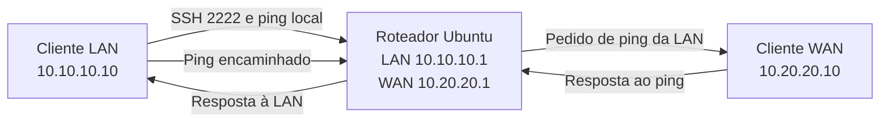

# Guia de estudo do firewall — Grupo 10

O projeto simula um pequeno provedor com uma rede LAN e uma rede WAN. Minha parte foi instalar um filtro no roteador Ubuntu entre essas redes. Com o filtro ativo, a LAN autorizada mantém acesso ao SSH e aos pings de diagnóstico. A WAN não consegue abrir uma conexão administrativa nem iniciar o tráfego de teste para a LAN.

## 1. Arquivos da entrega

| Arquivo | Por que está na entrega |
| --- | --- |
| [`firewall.sh`](firewall.sh) | Valida o ambiente, monta as regras do iptables, guarda o estado anterior e oferece os comandos de aplicação, inspeção e recuperação. |
| [`.dockerignore`](.dockerignore) | Limita o contexto adicional do Docker ao script. Documentação e evidências ficam fora da imagem. |
| [`Dockerfile`](../shozz-infra-lab/infraestrutura/Dockerfile) | Instala `iptables`, copia o script e normaliza os finais de linha para Linux. O firewall passa a ser chamado antes do script de inicialização do Gabriel. |
| [`docker-compose.yml`](../shozz-infra-lab/infraestrutura/docker-compose.yml) | Fornece o contexto adicional `firewall_src` e habilita o firewall na inicialização por padrão. A topologia continua usando a capacidade `NET_ADMIN` e os IPs já declarados. |
| [`README.md`](README.md) | Reúne a política completa, os comandos de operação e a tabela de resultados. |
| [`evidencias/`](evidencias/) | Guarda comandos, saídas e códigos de retorno da validação real. |
| `GUIA_ESTUDO_FIREWALL.md` | Explica como ler o código, interpretar a demonstração e responder às perguntas da arguição. |

## 2. Como a rede funciona



O cliente LAN tem uma rota para `10.20.20.0/24` via `10.10.10.1`. O cliente WAN tem uma rota para `10.10.10.0/24` via `10.20.20.1`. O Compose liga o roteador às duas bridges e ativa `net.ipv4.ip_forward=1`. Assim, o Linux pode encaminhar pacotes que não terminam nele. O firewall decide quais desses pacotes podem atravessar.

Os endereços `.254` são gateways das bridges Docker. O `10.10.10.254` é também a origem administrativa usada pelo host Linux na montagem do Gabriel. A regra de SSH aceita esse endereço somente quando o pacote chega pela LAN e procura o SSH em `10.10.10.1`. O cliente LAN `10.10.10.10` segue as mesmas exigências. As origens autorizadas também precisam de uma chave aceita pelo OpenSSH.

### As três cadeias

| Cadeia | Pergunta para identificar o caminho | Exemplo |
| --- | --- | --- |
| `INPUT` | O destino é um IP do próprio roteador? | LAN acessando `10.10.10.1:2222`. A WAN tentando alcançar `10.10.10.1:2222` também passa por `INPUT`, porque o endereço pertence ao roteador. |
| `OUTPUT` | Um processo do roteador criou o pacote? | O SSH responde ao cliente ou o roteador responde ao `ping` que recebeu. |
| `FORWARD` | O destino é outro equipamento e o pacote precisa atravessar o roteador? | `10.10.10.10` envia um ping a `10.20.20.10`. O pedido e a resposta atravessam `FORWARD`. |

`iptables` é a ferramenta usada para configurar regras do Netfilter, no kernel Linux. Neste teste, o comando mostrou `iptables v1.8.10 (nf_tables)`, indicando o backend usado para instalar as regras. A tabela `filter` decide quais pacotes entram, saem ou atravessam o roteador.

O **conntrack** guarda informações sobre os fluxos. `NEW` marca o início de um fluxo ou pacotes de um fluxo no qual o kernel ainda não viu tráfego nos dois sentidos. `ESTABLISHED` identifica tráfego de um fluxo que o kernel já observou nos dois sentidos. `RELATED` cobre tráfego associado a um fluxo existente, como certas mensagens ICMP de erro. `INVALID` indica que o pacote não pôde ser associado a um estado válido.

`DROP` descarta o pacote em silêncio. Escolhemos `DROP` como política padrão de `INPUT` e `FORWARD` para exigir autorização explícita. `OUTPUT` é `ACCEPT` porque o exercício não restringe o tráfego que o próprio roteador inicia. A autorização do tráfego de retorno evita abrir regras amplas para cada porta ou direção de resposta.

## 3. Como ler o `firewall.sh`

1. **Constantes e proteção do ambiente.** No começo ficam os IPs, as sub-redes e o caminho do backup. `require_router` exige o contêiner `ubuntu-router`, execução como root dentro dele e duas interfaces distintas com os IPs esperados. O script lê o nome atual de cada interface pelo endereço. Assim, a lógica não depende de a LAN ser `eth0` ou `eth1`.
2. **Políticas e verificações iniciais.** `render_rules` produz a tabela `filter`. O loopback é liberado para processos locais. `INVALID` é descartado. As checagens de origem rejeitam, por exemplo, um pacote que chega pela WAN alegando origem fora de `10.20.20.0/24`. Elas não identificam dois dispositivos que compartilham uma sub-rede.
3. **Cadeia de SSH.** Todo TCP destinado à porta `2222` passa primeiro por `SHOZZ_SSH`. A cadeia confere interface, endereço de destino e origem. Uma sessão estabelecida de origem autorizada segue normalmente. Um novo `SYN` autorizado vai para `SHOZZ_SSH_RATE`. Essa ordem impede que a aceitação genérica de `ESTABLISHED` mantenha um acesso SSH anterior que não atende à nova política.
4. **Limite de novos SSH.** `hashlimit` usa um orçamento por IP de origem. Cada origem pode usar até quatro créditos iniciais e recupera um crédito aproximadamente a cada cinco segundos, equivalente a `12/min`. Quando o orçamento acaba, o novo `SYN` é descartado. O limite vale por tentativa de estabelecimento TCP, sem examinar autenticação SSH. Um `SYN` retransmitido também pode usar crédito.
5. **Pings e retorno.** O script permite pings do cliente LAN ao roteador na LAN e do cliente LAN ao cliente WAN, com orçamentos separados de `3/s` e rajada de cinco. As regras de pedido de ping vêm antes de `ESTABLISHED` para que um pedido repetido do mesmo fluxo ainda passe pelo limite. As respostas e mensagens relacionadas têm uma regra de estado que as deixa voltar.
6. **Descarte com registro limitado.** `SHOZZ_INPUT_DENY`, `SHOZZ_FORWARD_DENY` e o excesso em `SHOZZ_SSH_RATE` usam um limite de log. Quando o orçamento do log termina, os pacotes seguem para o `DROP`. Os contadores mostram o que correspondeu a cada regra. Em Docker, a entrega de mensagens ao log de kernel depende do host.
7. **Snapshot e transação.** `apply` usa `flock` para evitar duas operações simultâneas do script. `save_filter` tira um snapshot e `iptables-restore --test` confere se ele pode ser lido de volta. O primeiro snapshot fica em `/run/shozz-firewall/filter-before.rules`. `install_filter` valida a tabela nova, instala-a e, se a instalação falhar, tenta repor o snapshot da tentativa. As tabelas de NAT e as regras do host Docker ficam fora dessa troca.
8. **Comandos e inicialização.** `status` lista regras e contadores. `restore` recupera o primeiro snapshot. `apply` carrega as mesmas regras novamente sem duplicá-las. Na inicialização, `start` aplica o firewall e usa `exec` para chamar o script do Gabriel, que gera chaves de host se preciso, valida a configuração e inicia o `sshd`. Se o contêiner for recriado, ele inicia em outro namespace e reaplica o firewall pela imagem. O comando de recuperação é pelo console Docker, mesmo quando o SSH fica inacessível.

### Efeito sobre varreduras, tentativas repetidas e DoS

Uma porta sem aplicação e sem filtro pode devolver um `RST`, e o Nmap mostra `closed`. Se o firewall descarta a sondagem, o Nmap pode mostrar `filtered` por falta de resposta. A mudança reduz a informação que a WAN consegue observar. Uma sondagem moderada também pode ver `filtered` por outros motivos, como perda de pacotes. Por isso, a demonstração usa um antes e depois e consulta os contadores do roteador.

Para o SSH, a lista de origens e o limite de novos SYN reduzem as conexões novas que chegam ao `sshd`. O login continua dependendo de chave pública, conforme o hardening do Gabriel. Para o ICMP, o limite reduz a quantidade de pedidos de ping aceitos. Isso protege recursos locais dentro do alcance do laboratório. Se um ataque distribuído saturar o enlace antes de chegar ao roteador, o filtro local não recupera a capacidade já ocupada.

## 4. Como os testes foram feitos

Os comandos abaixo partem de `shozz-infra-lab/infraestrutura`. O Nmap foi instalado nos clientes Alpine para a medição com `apk add --no-cache nmap`. Para o login de teste, também instalamos `openssh-client` na LAN. As sondagens Nmap ficaram restritas aos IPs e às portas a seguir.

```powershell
docker compose exec -T cliente-lan nmap -sT -n -Pn --reason --max-retries 1 -p 22,80,2222 10.10.10.1
docker compose exec -T cliente-wan nmap -sT -n -Pn --reason --max-retries 1 -p 22,80,2222 10.20.20.1
docker compose exec -T cliente-wan nmap -sT -n -Pn --reason --max-retries 1 -p 2222 10.10.10.1
docker compose exec -T cliente-wan nmap -sT -n -Pn --reason --max-retries 1 -p 8080 10.10.10.10
```

- `-sT` pede conexões TCP comuns. `-n` evita resolver nomes. `-Pn` mede as portas mesmo quando o alvo não responde à descoberta. `-p` escolhe explicitamente as portas. `--reason` mostra por que o Nmap decidiu o estado e `--max-retries 1` limita as novas tentativas de sondagem do Nmap.
- O primeiro comando verifica `INPUT` pela LAN. O segundo verifica `INPUT` pela WAN. O terceiro confirma que, vindo da WAN, nem o endereço administrativo da LAN abre o SSH. O quarto tem como destino outro cliente, de modo que mede `FORWARD`. A porta 8080 não tinha aplicação escutando e serviu para comparar `closed` com `filtered`.
- O rótulo de serviço mostrado pelo Nmap para a porta 2222 veio da tabela de portas. Neste teste não pedimos detecção de serviços. Identificamos a aplicação pela escuta registrada pelo `sshd` e pelo login realizado. [Explicação dos estados do Nmap](https://nmap.org/book/man-port-scanning-basics.html)
- Para testar **rota e retorno**, consultamos `ip route get` nos clientes, verificamos `net.ipv4.ip_forward` no roteador e mandamos dois pings por direção. Depois do firewall, a LAN continuou recebendo as respostas, e os pedidos iniciados na WAN expiraram.
- Para provar **autenticação**, foi criada uma chave descartável dentro do cliente LAN. A chave pública foi autorizada só para essa origem e para o comando `id -un`. A chave pública do host SSH foi conferida pelo console do Docker e usada em um `known_hosts` temporário. O login retornou `ubuntu`. A autorização original foi restaurada e conferida por hash, e os arquivos temporários do teste foram removidos.
- Para medir **limite de SSH**, foram feitas seis sondagens TCP comuns, com destino à mesma porta. O contador `ACCEPT` em `SHOZZ_SSH_RATE` aumentou em quatro, e `DROP` aumentou em dois. Depois de esperar seis segundos, um novo teste encontrou a porta aberta de novo. Comparamos os contadores antes e depois para contar só os pacotes dessa medição. O procedimento e a saída ficam em [`05-limite.txt`](evidencias/05-limite.txt).
- Para medir **limite de ICMP**, foram enviados sete pings da LAN para `10.10.10.1` e, em seguida, sete para `10.20.20.10`. Em cada caminho, cinco receberam resposta e dois foram descartados. O primeiro resultado é de `INPUT`, e o segundo é de `FORWARD`. Os contadores de ambas as cadeias confirmaram o motivo da perda. [Revalidação e comandos](evidencias/08-icmp-revalidacao.txt)
- Para provar **recuperação**, voltamos ao snapshot pelo console Docker, conferimos a política e repetimos o Nmap de WAN para `10.20.20.1:2222`. Reaplicamos o firewall logo depois. Para comparar reinstalação e reinício, registramos os IDs dos contêineres e a reaplicação no log.

### Leitura das evidências

| Evidência | O que conferir |
| --- | --- |
| [`01-antes.txt`](evidencias/01-antes.txt) | IPs e rotas iniciais, `2222/tcp open` nas duas origens, `8080/tcp closed` no cliente LAN antes de filtrar. |
| [`02-integracao.txt`](evidencias/02-integracao.txt) | Validação em contêiner isolado, ID novo para o roteador, IDs iguais para os clientes, início automático com `DROP` e hashes iguais dos arquivos do SSH. |
| [`03-depois.txt`](evidencias/03-depois.txt) | `2222/tcp open` pela LAN, `2222/tcp filtered` pela WAN, `8080/tcp filtered` no teste encaminhado e descartes nos contadores. |
| [`04-ssh-lan.txt`](evidencias/04-ssh-lan.txt) | Comando SSH retornando `ubuntu` e hash do `authorized_keys` igual antes e depois do teste. |
| [`05-limite.txt`](evidencias/05-limite.txt) | Sondagens admitidas, sondagens limitadas e o retorno da disponibilidade quando há novo crédito. |
| [`06-recuperacao.txt`](evidencias/06-recuperacao.txt) | Snapshot inicial, retorno a `ACCEPT` durante a restauração, retomada de `DROP`, reaplicação no reinício e três contêineres em execução. |
| [`07-icmp-hardening.txt`](evidencias/07-icmp-hardening.txt) | Configuração efetiva do SSH e primeira coleta de ICMP. A checagem automática do contador parou porque o formato de `iptables -L` não mostra o nome interno do limite. |
| [`08-icmp-revalidacao.txt`](evidencias/08-icmp-revalidacao.txt) | Repetição da coleta. Confirma a autenticação exclusivamente por chave em `sshd -T` e cinco pings aceitos e dois descartados em cada caminho. |

## 5. Limitações e possíveis falhas

- O filtro atua só no IPv4 do roteador. Pacotes trocados na mesma bridge ou enviados pelo gateway Docker podem seguir outro caminho. Uma eventual ativação de IPv6 exigiria política e testes próprios.
- O `.254` da LAN está na lista para manter a forma de administração do host Linux. O login real desta rodada foi medido a partir do cliente LAN `.10`. O caminho direto do host Windows pela bridge Docker não foi usado.
- O firewall pode limitar inclusive um administrador que reabre conexões muito rápido. Os limites por IP precisam ser escolhidos para a carga real, principalmente quando vários usuários compartilham um endereço de origem.
- Um IP da mesma LAN não é prova de identidade. A autenticação por chave e a verificação da chave de host são controles distintos que continuam valendo.
- Uma ferramenta como Nmap não consegue provar, sozinha, se um timeout vem deste firewall. Os contadores e o antes/depois dão evidência complementar.
- Alterações inesperadas nos IPs do laboratório fazem a validação parar antes de mexer no filtro. Se a imagem não iniciar por erro nas regras, o README descreve o modo temporário de diagnóstico. Se apenas o SSH ficar bloqueado, a restauração também pode ser feita com `docker compose exec`.
- Um DoS pequeno de conexões e um DDoS que satura a Internet do provedor exigem medidas diferentes. O laboratório mede a decisão local com poucos pacotes. Ele não mede volume de mitigação e não prova proteção contra ataques distribuídos. O registro real no log de kernel também não foi medido.

## 6. Perguntas de arguição

1. **Qual foi a sua contribuição?** Implementei o filtro IPv4 do roteador, integrei a aplicação e a recuperação no Docker e medi a diferença antes e depois das regras.
2. **Onde o firewall roda?** No namespace de rede do roteador Ubuntu. O Compose concede `NET_ADMIN` para administrar essa rede.
3. **O que é `iptables`?** É a ferramenta que configura regras do Netfilter. O kernel avalia os pacotes usando essas regras.
4. **Quando um pacote usa `INPUT`?** Quando o endereço de destino é do próprio roteador. Um SSH para `10.10.10.1` usa `INPUT` mesmo se vier da WAN.
5. **Quando usa `FORWARD`?** Quando o destino é outro equipamento e o roteador só faz o encaminhamento. Um ping de cliente a cliente entre bridges é um exemplo.
6. **Quando usa `OUTPUT`?** Quando um processo local cria o pacote. Uma resposta do `sshd` do roteador usa `OUTPUT`.
7. **Por que `DROP` na política padrão?** Porque todo caminho de entrada ou encaminhamento precisa de uma permissão explícita. A regra padrão descarta os demais em silêncio.
8. **O que o conntrack guarda?** Estado dos fluxos observados. Ele ajuda o filtro a identificar tráfego que faz parte de uma comunicação já vista.
9. **Qual a diferença entre `ESTABLISHED` e `RELATED`?** `ESTABLISHED` pertence ao fluxo já observado nos dois sentidos. `RELATED` tem ligação com um fluxo existente, como uma mensagem ICMP de erro correspondente.
10. **Por que tentar SSH pela WAN dá timeout?** A regra exige entrada pela interface LAN e origem autorizada. O pacote que não passa na checagem é descartado.
11. **Quem pode usar SSH pela LAN?** `10.10.10.10` e `10.10.10.254`, pela interface LAN, com destino a `10.10.10.1:2222` e uma chave que o OpenSSH aceite.
12. **Por que só permitir a porta 2222 não basta?** A porta escolhe o serviço. O IP e a interface limitam quem chega nele. A chave autentica o usuário.
13. **Por que validar a chave do host?** Para confirmar que o cliente está falando com o servidor esperado. É uma verificação separada da chave usada pelo usuário para entrar.
14. **Como o SSH é limitado?** `hashlimit` dá quatro créditos iniciais e repõe cerca de um a cada cinco segundos por IP de origem autorizado.
15. **O limite detecta senha errada?** Ele vê o começo da conexão TCP. A decisão sobre autenticação fica com o `sshd`, que neste laboratório trabalha com chaves.
16. **Como o firewall reduz a informação de uma varredura?** O descarte silencioso troca uma resposta como `RST` por ausência de resposta. No Nmap deste teste, isso apareceu como `filtered`.
17. **O que indica `open`, `closed` e `filtered`?** `open` significa que a conexão foi aceita, `closed` que houve recusa, e `filtered` que a sondagem não teve resposta suficiente para o Nmap determinar se havia serviço.
18. **Por que usamos `-Pn` no Nmap?** Para testar as portas selecionadas mesmo se os pacotes de descoberta não tiverem resposta.
19. **Como a LAN ainda alcança a WAN por ping?** O roteamento leva o pedido ao roteador. A regra de `FORWARD` permite esse pedido da LAN e o conntrack reconhece a resposta que volta.
20. **O que o limite de log muda?** Ele limita a escrita de registros. O `DROP` continua executando mesmo quando a regra de log está sem crédito.
21. **Como evitar ficar sem acesso após aplicar `DROP`?** Guardar e validar o snapshot antes da troca. Se necessário, restaurar pelo console Docker, que independe do SSH.
22. **Posso aplicar o script duas vezes?** Sim. Ele carrega o mesmo conjunto da tabela `filter` e mantém o primeiro backup. As regras não passam a existir em duplicidade.
23. **O que ocorre ao recriar o roteador?** O contêiner recebe outro namespace. O entrypoint aplica o filtro de novo, cria o backup do estado inicial e depois aciona o SSH.
24. **Esse firewall resolve DDoS volumétrico?** Os limites atuam nos pacotes que já chegaram ao roteador. Uma saturação do enlace exige controles a montante e capacidade adequada.
25. **O que ainda merece teste?** O login pelo gateway `.254` direto de um host Linux, o registro dos descartes no log de kernel do host e cenários de outros protocolos ou endereçamento IPv6.

## 7. Roteiro oral de cinco minutos

Antes da apresentação, abra o PowerShell em `shozz-infra-lab/infraestrutura`. Deixe o `docker compose ps` com os três serviços em execução e o Nmap disponível nos dois clientes. Abra os arquivos de evidência em abas para mostrar as linhas exatas sem gastar tempo procurando.

| Tempo | O que dizer e mostrar |
| --- | --- |
| **0:00–0:45** | Mostre o diagrama. Aponte os dois IPs do roteador e as rotas dos clientes. Explique que o Gabriel construiu a rede e o SSH, e que seu filtro foi instalado no roteador. |
| **0:45–1:30** | Mostre `iptables -S`. Leia as políticas `INPUT DROP` e `FORWARD DROP`. Use SSH ao roteador como exemplo de `INPUT` e o ping até o outro cliente como exemplo de `FORWARD`. |
| **1:30–2:45** | Mostre a linha `2222/tcp open` pela WAN em `01-antes.txt`. Rode Nmap pela LAN e pela WAN. Compare `open` na LAN e `filtered` na WAN. Mostre o retorno `ubuntu` em `04-ssh-lan.txt` para distinguir conexão TCP de login autenticado. |
| **2:45–3:35** | Rode o ping LAN → WAN. Mostre a evidência do ping iniciado pela WAN que já foi descartado. Explique que o conntrack permite o retorno de um fluxo permitido. |
| **3:35–4:25** | Abra `05-limite.txt` e compare admissões e descartes dos seis testes. Explique a reposição de créditos. Mostre os contadores com `shozz-firewall status`. |
| **4:25–5:00** | Mostre o snapshot e as etapas de recuperação em `06-recuperacao.txt`. Feche explicando que o limite atua dentro do roteador e que o laboratório não mediu proteção contra DDoS volumétrico. |

Comandos para a demonstração ao vivo.

```powershell
docker compose ps
docker compose exec -T ubuntu-router iptables -S
Select-String '2222/tcp' ../../firewall/evidencias/01-antes.txt
docker compose exec -T cliente-lan nmap -sT -n -Pn --reason -p 2222 10.10.10.1
docker compose exec -T cliente-wan nmap -sT -n -Pn --reason -p 2222 10.20.20.1
docker compose exec -T cliente-lan ping -c 2 -W 1 10.20.20.10
docker compose exec -T ubuntu-router shozz-firewall status
Select-String 'Delta de pacotes' ../../firewall/evidencias/05-limite.txt
```

Para demonstrar a recuperação ao vivo, use a sequência do [README](README.md#recuperação-e-reaplicação) em uma janela reservada do laboratório. Termine a demonstração com `apply` e confirme novamente as políticas `DROP`.
