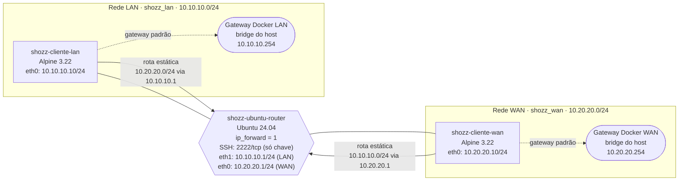

# Shozz Infra Lab — Infraestrutura LAN/WAN, Roteamento e SSH Seguro com Docker

> Projeto acadêmico de **Segurança da Informação**, com um laboratório autorizado pelo professor da disciplina.
> Este documento cobre a parte de **infraestrutura**: redes LAN/WAN, roteamento, SSH seguro e hardening do roteador Ubuntu.
> Firewall, testes de varredura e DoS, criptografia e integridade pertencem a outros integrantes e estão fora deste documento.
> O documento geral do grupo é o [`README.md` da raiz](../README.md).

---

## Sumário

1. [Descrição e objetivo](#1-descrição-e-objetivo)
2. [Contextualização do laboratório](#2-contextualização-do-laboratório)
3. [Tecnologias utilizadas](#3-tecnologias-utilizadas)
4. [Arquitetura da infraestrutura](#4-arquitetura-da-infraestrutura)
5. [Diagrama da topologia](#5-diagrama-da-topologia)
6. [Tabela de endereçamento IP](#6-tabela-de-endereçamento-ip)
7. [Os três contêineres](#7-os-três-contêineres)
8. [Configuração das redes Docker](#8-configuração-das-redes-docker)
9. [Funcionamento do roteador Ubuntu](#9-funcionamento-do-roteador-ubuntu)
10. [Encaminhamento IPv4](#10-encaminhamento-ipv4)
11. [Rotas: diretamente conectadas, estáticas e gateway padrão](#11-rotas-diretamente-conectadas-estáticas-e-gateway-padrão)
12. [Configuração do SSH](#12-configuração-do-ssh)
13. [Hardening aplicado](#13-hardening-aplicado)
14. [Procedimentos de inicialização](#14-procedimentos-de-inicialização)
15. [Comandos úteis de administração](#15-comandos-úteis-de-administração)
16. [Testes executados](#16-testes-executados)
17. [Resultados reais dos testes](#17-resultados-reais-dos-testes)
18. [Evidências](#18-evidências)
19. [Limitações e considerações técnicas](#19-limitações-e-considerações-técnicas)
20. [Itens concluídos e pendentes](#20-itens-concluídos-e-pendentes)
21. [Conclusão](#21-conclusão)

---

## 1. Descrição e objetivo

O **Shozz Infra Lab** simula, com contêineres Docker, uma pequena infraestrutura com **duas sub-redes IPv4 interligadas por um roteador Linux (Ubuntu 24.04)**, cujo acesso administrativo é feito por **SSH endurecido**.

Objetivos:

- montar uma topologia LAN/WAN com duas sub-redes separadas, fácil de reproduzir;
- configurar um contêiner Ubuntu como **roteador**, com uma interface em cada sub-rede e encaminhamento IPv4 ativo;
- configurar clientes que só alcançam a rede oposta **através do roteador**;
- proteger o acesso administrativo ao roteador: **SSH na porta 2222, somente por chave, sem root e restrito a um usuário**;
- aplicar hardening compatível com o ambiente de contêiner;
- **comprovar tudo com testes reais** e evidências salvas.

## 2. Contextualização do laboratório

Em redes reais, um roteador interliga segmentos diferentes, como uma rede interna (LAN) e uma rede externa (WAN). Ele é o ponto natural para aplicar controles de segurança: acesso administrativo restrito, filtragem de pacotes e registro de eventos.

O ambiente roda **inteiramente em uma única máquina física** (host Linux Mint), com Docker. Os motivos dessa escolha:

- o ambiente sobe em segundos e é idêntico para todos os integrantes;
- nenhuma porta dos contêineres é publicada no host (`ports:` não é usado), então nenhum serviço do laboratório fica acessível a conexões vindas de fora do host;
- toda a configuração está em código (`Dockerfile`, `docker-compose.yml` e arquivos de `hardening/`), o que permite revisá-la e versioná-la.

> **Atenção: isso não significa isolamento de saída.** As redes usam `driver: bridge` comum e **não** declaram `internal: true`. Nesse modo, o Docker normalmente permite que os contêineres iniciem conexões para fora através do host, usando NAT (*masquerade*). O bloqueio do tráfego de saída **não foi configurado nem comprovado** (veja a [seção 8](#8-configuração-das-redes-docker)).

> **Importante: isto não é uma máquina virtual.** Os contêineres Docker **compartilham o kernel Linux do host**. O contêiner "Ubuntu" tem o *espaço de usuário* do Ubuntu 24.04 (bibliotecas, `apt`, `iproute2`, `openssh-server`), mas o kernel, e com ele a pilha TCP/IP, é o do host. Cada contêiner tem seu próprio **namespace de rede**: interfaces, rotas, tabela ARP e parâmetros `net.*` isolados. Isso basta para simular roteamento e um serviço SSH, mas **não é um Ubuntu Server completo**. Não há `systemd`, não há boot próprio, não há Netplan e não existe um kernel separado. Por isso, todo hardening descrito aqui vale **para o contêiner**, e **não** para o host Linux Mint.

## 3. Tecnologias utilizadas

| Tecnologia | Versão observada | Papel |
|---|---|---|
| Docker Engine | 29.10.0 | Execução dos contêineres e criação das redes |
| Docker Compose | v5.8.0 | Declaração da topologia: serviços, redes e IPs |
| Kernel Linux do host | 7.0.0-43-generic | Pilha de rede compartilhada por todos os contêineres |
| Ubuntu | 24.04.5 LTS (Noble Numbat) | Espaço de usuário do roteador |
| Alpine Linux | 3.22 | Clientes LAN e WAN (imagem mínima, ferramentas BusyBox) |
| OpenSSH (servidor no roteador) | 9.6p1 (`1:9.6p1-3ubuntu13.20`) | Acesso administrativo ao roteador |
| OpenSSH (cliente no host) | 9.6p1 | Testes de autenticação |
| `iproute2` | 6.1.0 | `ip addr`, `ip route`, `ip neigh`, `ss` no roteador |
| `iputils-ping` | 20240117 | `ping` no roteador |
| BusyBox (`ip`, `ping`, `traceroute`, `nc`) | 1.37.0 | Ferramentas de rede nos clientes Alpine |

## 4. Arquitetura da infraestrutura

Estrutura desta parte do repositório:

```text
shozz-infra-lab/
├── README.md                              ← este documento
├── .dockerignore                          ← limita o contexto de build ao necessário
├── infraestrutura/
│   ├── Dockerfile                         ← imagem do roteador Ubuntu 24.04 (com hardening)
│   └── docker-compose.yml                 ← contêineres, redes e endereçamento
├── hardening/
│   ├── entrypoint.sh                      ← gera chaves de host, valida e inicia o sshd
│   ├── ssh/
│   │   ├── 10-shozz-hardening.conf        ← configuração endurecida do OpenSSH
│   │   └── authorized_keys                ← chave PÚBLICA autorizada do usuário ubuntu
│   └── backup/                            ← cópias anteriores ao hardening
└── evidencias/
    └── infraestrutura/
        ├── testes-rede.md                 ← registro detalhado das auditorias e testes
        └── saidas/                        ← saídas brutas dos comandos (00 a 39)
```

A arquitetura tem três elementos:

1. **Duas redes Docker do tipo *bridge*** (`shozz_lan` e `shozz_wan`). Cada uma funciona como um switch virtual no host.
2. **Um roteador Ubuntu**, ligado às duas redes, com `ip_forward` ativo e o SSH endurecido na porta 2222.
3. **Dois clientes Alpine**, cada um ligado a apenas uma rede, com uma rota estática que aponta para o roteador.

## 5. Diagrama da topologia



As linhas cheias mostram o caminho real do tráfego entre as sub-redes. As linhas tracejadas mostram o gateway padrão de cada cliente, que é a bridge do host Docker e **não** participa da comunicação LAN ↔ WAN. O próprio host, por estar ligado às duas bridges (`.254`), alcança o SSH do roteador sem nenhuma porta publicada.

## 6. Tabela de endereçamento IP

| Equipamento | Rede Docker | Interface | Endereço | Confirmado |
|---|---|---|---|---|
| Ubuntu (roteador) — LAN | `shozz_lan` | `eth1` | `10.10.10.1/24` | ✅ |
| Ubuntu (roteador) — WAN | `shozz_wan` | `eth0` | `10.20.20.1/24` | ✅ |
| Cliente LAN | `shozz_lan` | `eth0` | `10.10.10.10/24` | ✅ |
| Cliente WAN | `shozz_wan` | `eth0` | `10.20.20.10/24` | ✅ |
| Gateway Docker LAN (bridge no host) | `shozz_lan` | — | `10.10.10.254` | ✅ |
| Gateway Docker WAN (bridge no host) | `shozz_wan` | — | `10.20.20.254` | ✅ |

> O `docker-compose.yml` define **explicitamente** o gateway de cada rede Docker: `10.10.10.254` na LAN e `10.20.20.254` na WAN. Com o gateway do IPAM fixado em `.254`, os endereços `.1` ficam livres e podem ser atribuídos ao roteador Ubuntu.
>
> Os nomes `eth0` e `eth1` do roteador dependem da ordem em que o Docker conecta as redes. Eles se mantiveram depois da recriação do roteador em 2026-11-24 ([`28`](evidencias/infraestrutura/saidas/28-final-interfaces-rotas-forward.txt)), mas isso não é garantido. Para identificar uma interface, use o **endereço IP**.

## 7. Os três contêineres

### `shozz-ubuntu-router` — roteador

| Item | Configuração |
|---|---|
| Imagem | construída a partir de [`infraestrutura/Dockerfile`](infraestrutura/Dockerfile) (base `ubuntu:24.04`, contexto de build `shozz-infra-lab/`) |
| Hostname | `ubuntu-router` |
| Redes | `shozz_lan` (10.10.10.1) e `shozz_wan` (10.20.20.1) |
| Capacidade extra | `NET_ADMIN`, que permite administrar interfaces e rotas no próprio namespace |
| `sysctls` | `net.ipv4.ip_forward: "1"` |
| Processo principal | [`hardening/entrypoint.sh`](hardening/entrypoint.sh) → `ssh-keygen -A`, `sshd -t` e `exec sshd -D -e` (o sshd vira o PID 1) |
| Serviço exposto | SSH em `2222/tcp`, sem publicação no host |
| Pacotes explícitos | `iproute2`, `iputils-ping`, `openssh-server`, `sudo`, `ca-certificates` |

### `shozz-cliente-lan` — cliente da LAN

| Item | Configuração |
|---|---|
| Imagem | `alpine:3.22` |
| Rede | `shozz_lan` (10.10.10.10) |
| Capacidade extra | `NET_ADMIN`, necessária para criar a rota estática |
| Comando | `ip route replace 10.20.20.0/24 via 10.10.10.1 && exec sleep infinity` |

### `shozz-cliente-wan` — cliente da WAN

| Item | Configuração |
|---|---|
| Imagem | `alpine:3.22` |
| Rede | `shozz_wan` (10.20.20.10) |
| Capacidade extra | `NET_ADMIN` |
| Comando | `ip route replace 10.10.10.0/24 via 10.20.20.1 && exec sleep infinity` |

O `exec sleep infinity` mantém os clientes em execução. Eles não oferecem nenhum serviço e servem apenas como origem e destino dos testes.

## 8. Configuração das redes Docker

O endereçamento é **gerenciado pelo Docker Compose** através do IPAM (*IP Address Management*) do Docker. Nenhum arquivo de rede é configurado dentro dos contêineres: **não se usa Netplan, `/etc/network/interfaces` nem DHCP**. Na criação do contêiner, o Docker atribui o endereço declarado em `ipv4_address`.

```yaml
networks:
  shozz_lan:
    name: shozz_lan
    driver: bridge
    ipam:
      config:
        - subnet: 10.10.10.0/24
          gateway: 10.10.10.254
  shozz_wan:
    name: shozz_wan
    driver: bridge
    ipam:
      config:
        - subnet: 10.20.20.0/24
          gateway: 10.20.20.254
```

- **`driver: bridge`**: o Docker cria no host uma interface *bridge* (um switch virtual) para cada rede. Cada contêiner se liga a ela por um par de interfaces virtuais (*veth*). Do lado do contêiner, a ponta aparece como `eth0@ifNN`.
- **`subnet`**: o bloco de endereços da rede.
- **`gateway`**: o endereço que a bridge do host recebe. O Docker o usa como gateway padrão dos contêineres. Aqui ele foi definido explicitamente como `10.10.10.254` (LAN) e `10.20.20.254` (WAN), o que deixa os endereços `.1` livres para o roteador Ubuntu.
- **`name:`**: fixa o nome da rede (`shozz_lan`/`shozz_wan`) para que ele não ganhe o prefixo do projeto.

### Separação e exposição das redes

| Aspecto | Situação atual | Base |
|---|---|---|
| Separação entre LAN e WAN | São duas bridges distintas. Cada cliente está ligado a apenas uma delas, e o único contêiner presente nas duas é o roteador. | [`02`](evidencias/infraestrutura/saidas/02-redes-docker.txt), [`27`](evidencias/infraestrutura/saidas/27-final-estado-conteineres-redes.txt) |
| Conexões de **entrada** vindas de fora do host | Não há portas publicadas (`ports:` ausente; `docker port` vazio). O SSH (2222) só é alcançável a partir do próprio host e das redes do laboratório. | [`27`](evidencias/infraestrutura/saidas/27-final-estado-conteineres-redes.txt) |
| Conexões de **saída** dos contêineres | **Não bloqueadas por configuração.** As redes não são `internal` (`internal=false`). Em redes bridge comuns, o Docker normalmente aplica NAT (*masquerade*) no host, o que permite que os contêineres alcancem redes externas pelo gateway `.254`. | [`16`](evidencias/infraestrutura/saidas/16-verificacoes-complementares.txt), [`27`](evidencias/infraestrutura/saidas/27-final-estado-conteineres-redes.txt) |

**Não publicar portas** impede que alguém de fora **inicie** conexões com os contêineres. Isso não impede que os contêineres **iniciem** conexões para fora. São controles diferentes. As regras de NAT do host não foram inspecionadas, e nenhum teste de saída para a Internet foi feito. Por isso, o comportamento de saída está descrito como o padrão do Docker, e **não como algo comprovado**.

### Análise de `internal: true` (decisão: adiado)

| Efeito esperado de `internal: true` | Consequência no laboratório |
|---|---|
| O Docker deixa de fazer NAT de saída para essas redes | Bloqueio de saída para redes externas (o objetivo) |
| Os contêineres deixam de receber rota padrão para o gateway `.254` | Os clientes ficam só com a rede local e a rota estática para o roteador. O roteamento LAN ↔ WAN acontece dentro do namespace do roteador e não depende do host, então deve continuar funcionando, **mas isso precisa ser testado** |
| Sem acesso à Internet em tempo de execução | `apt`/`apk` deixam de funcionar dentro dos contêineres. Ferramentas como Nmap teriam de vir já na imagem, o que **afeta o trabalho de outros integrantes** |
| Exige recriar as duas redes e os três contêineres | Interrupção de todo o laboratório |

O acesso do host ao SSH (via `.254`) também precisaria ser revalidado, porque o tratamento do gateway em redes internas pode variar entre versões do Docker. **Decisão desta etapa:** não aplicar. A mudança deve ser combinada com os integrantes responsáveis por firewall e testes e, se adotada, comprovada com testes de roteamento, de SSH e de bloqueio de saída. Este documento **não** afirma que existe isolamento de saída.

## 9. Funcionamento do roteador Ubuntu

O contêiner `shozz-ubuntu-router` está ligado às duas bridges ao mesmo tempo e, por isso, tem uma interface em cada sub-rede. Quando um pacote chega por uma interface com destino à outra sub-rede, o kernel faz o seguinte:

1. consulta a tabela de rotas e verifica que o destino **não** é um endereço local do roteador. A rota encontrada é a rota diretamente conectada da sub-rede de destino;
2. como o pacote não é para ele, o kernel só o encaminha se o encaminhamento estiver habilitado (`ip_forward = 1`). Caso contrário, o pacote é descartado;
3. **decrementa o TTL** do pacote em 1;
4. envia o pacote pela interface de saída indicada pela rota;
5. para isso, resolve por ARP o MAC do destino final, que está na sub-rede diretamente conectada a essa interface.

Exemplo de caminho LAN → WAN:

```text
cliente-lan (10.10.10.10)
   │  quadro destinado ao MAC da eth1 do roteador
   ▼
roteador eth1 (10.10.10.1) ──[kernel: forward, TTL 64→63]──► roteador eth0 (10.20.20.1)
                                                                 │
                                                                 ▼
                                                    cliente-wan (10.20.20.10)
```

## 10. Encaminhamento IPv4

Por padrão, um host Linux **descarta** pacotes cujo destino não é ele mesmo. O parâmetro `net.ipv4.ip_forward` muda esse comportamento:

| Valor | Comportamento |
|---|---|
| `0` | Host comum: só aceita pacotes destinados a ele |
| `1` | Roteador: encaminha pacotes entre interfaces de acordo com a tabela de rotas |

Neste laboratório, o parâmetro é definido no Compose:

```yaml
sysctls:
  net.ipv4.ip_forward: "1"
```

Essa opção do Compose atua **apenas no namespace de rede do contêiner roteador** e garante ali o valor `1`, independentemente de qualquer outro fator. Para verificar:

```bash
docker exec shozz-ubuntu-router sysctl net.ipv4.ip_forward
# net.ipv4.ip_forward = 1
```

> **Observação** ([`16`](evidencias/infraestrutura/saidas/16-verificacoes-complementares.txt)): o host e os dois clientes **também** apresentam `ip_forward = 1`. O Compose não define esse valor para os clientes. No host, o próprio Docker habilita o encaminhamento para operar as redes bridge, e neste ambiente os namespaces dos clientes ficaram com o mesmo valor. Isso não transforma os clientes em roteadores: cada um tem **uma única interface** e não recebe tráfego de outra sub-rede para repassar. O papel de roteador entre LAN e WAN é do contêiner Ubuntu, como mostram o `traceroute` e o contador `ForwDatagrams` ([seção 17](#17-resultados-reais-dos-testes)).

## 11. Rotas: diretamente conectadas, estáticas e gateway padrão

Tabelas confirmadas no estado final (2026-11-24, [`28`](evidencias/infraestrutura/saidas/28-final-interfaces-rotas-forward.txt)), idênticas às da primeira auditoria:

```text
# Roteador
default via 10.10.10.254 dev eth1
10.10.10.0/24 dev eth1 proto kernel scope link src 10.10.10.1
10.20.20.0/24 dev eth0 proto kernel scope link src 10.20.20.1

# Cliente LAN
default via 10.10.10.254 dev eth0
10.10.10.0/24 dev eth0 scope link  src 10.10.10.10
10.20.20.0/24 via 10.10.10.1 dev eth0

# Cliente WAN
default via 10.20.20.254 dev eth0
10.10.10.0/24 via 10.20.20.1 dev eth0
10.20.20.0/24 dev eth0 scope link  src 10.20.20.10
```

### Rotas diretamente conectadas (no roteador)

Quando uma interface recebe um endereço com máscara, por exemplo `10.10.10.1/24`, o **kernel cria sozinho** uma rota para essa sub-rede. Na tabela, ela aparece com `proto kernel scope link` e **não tem `via`**: o destino está no mesmo enlace e é alcançado diretamente por ARP. O roteador conhece as duas sub-redes justamente porque tem uma interface em cada uma. **Por isso não foi preciso configurar nenhuma rota manual no roteador.**

### Rotas estáticas (nos clientes)

Cada cliente conhece de forma direta apenas a própria sub-rede. Para alcançar a outra, ele precisa de uma rota configurada **manualmente** que indique o **próximo salto** (`via`):

- cliente LAN: `10.20.20.0/24 via 10.10.10.1`, ou seja, "para chegar à WAN, entregue ao roteador";
- cliente WAN: `10.10.10.0/24 via 10.20.20.1`, ou seja, "para chegar à LAN, entregue ao roteador".

Essas rotas são criadas pelo `command` de cada contêiner (`ip route replace ...`) sempre que ele inicia. O próximo salto precisa estar na sub-rede local do cliente, e isso é verdade aqui. Como apontam para o **endereço IP** do roteador, as rotas continuaram válidas quando só o roteador foi recriado.

### Gateway padrão

A rota `default` é usada **quando nenhuma rota mais específica corresponde ao destino**. O kernel sempre escolhe o prefixo mais longo (*longest prefix match*): um `/24` vence o `/0` da rota padrão.

- Nos clientes, o gateway padrão é a bridge do host Docker (`.254`). Destinos como a Internet seguiriam por ele, mas a rede oposta do laboratório **não**, porque a rota estática `/24` é mais específica.
- No roteador, a rota padrão é `via 10.10.10.254 dev eth1`, escolhida pelo Docker pela rede LAN. Em uma rede real, a rota padrão normalmente apontaria para a WAN. Aqui, a "WAN" é só uma segunda sub-rede interna, sem saída própria para a Internet. Isso não afeta o roteamento entre LAN e WAN.

| Tipo | Onde aparece | Como surge | Tem `via`? | Exemplo |
|---|---|---|---|---|
| Diretamente conectada | Roteador e clientes | Automaticamente, ao configurar o IP na interface | Não | `10.10.10.0/24 dev eth1 proto kernel` |
| Estática | Clientes | Manualmente (`ip route replace`) | Sim | `10.20.20.0/24 via 10.10.10.1` |
| Gateway padrão | Todos | Atribuída pelo Docker (gateway do IPAM) | Sim | `default via 10.10.10.254` |

## 12. Configuração do SSH

### 12.1 Estado inicial e estado final

| Item | Inicial ([`15`](evidencias/infraestrutura/saidas/15-estado-ssh-atual.txt)) | Final, efetivo pelo `sshd -T` ([`32`](evidencias/infraestrutura/saidas/32-final-ssh-configuracao-efetiva.txt)) |
|---|---|---|
| Porta | 22 (com `EXPOSE 2222` divergente) | **2222**, coerente com o `EXPOSE 2222` |
| Família de endereços | IPv4 e IPv6 | `inet` (só IPv4, como o laboratório) |
| Login de root | `without-password` (root entrava com chave) | **`no`** |
| Usuários permitidos | qualquer um | **`AllowUsers ubuntu`** |
| Métodos de autenticação | `publickey` e `password` | **somente `publickey`** (`AuthenticationMethods publickey`) |
| `PasswordAuthentication` | `yes` | **`no`** |
| `KbdInteractiveAuthentication` | `no` | `no` |
| `MaxAuthTries` / `LoginGraceTime` | 6 / 120 s | **3 / 30 s** |
| `X11Forwarding` / `AllowTcpForwarding` / `AllowAgentForwarding` | `yes` / `yes` / `yes` | **`no` / `no` / `no`** |
| `PermitTunnel` | `no` | `no` |
| Banner de versão | `OpenSSH_9.6p1 Ubuntu-3ubuntu13.20` | `OpenSSH_9.6p1` (`DebianBanner no`) |
| `LogLevel` | `INFO` | **`VERBOSE`** (registra a impressão digital da chave usada) |
| Criptografia | inclui `hmac-sha1`, `umac-64`, `ecdh-nistp*` e `diffie-hellman-*` | somente KEX `sntrup761`/`curve25519`, cifras AEAD/CTR e MACs `-etm` SHA-2/UMAC-128 |
| Chaves de host | **geradas no build e embutidas na imagem** (`root@buildkitsandbox`) | **geradas na inicialização de cada contêiner** (`root@ubuntu-router`) |

### 12.2 Onde a configuração fica

- [`hardening/ssh/10-shozz-hardening.conf`](hardening/ssh/10-shozz-hardening.conf) é copiado para `/etc/ssh/sshd_config.d/`. O `sshd_config` padrão do Ubuntu inclui esse diretório **na primeira linha útil**, e no OpenSSH vale o **primeiro** valor lido de cada opção. Por isso o arquivo tem precedência sobre o restante, e o `sshd_config` original ficou intacto.
- [`hardening/ssh/authorized_keys`](hardening/ssh/authorized_keys) contém **apenas a chave pública** do laboratório (ED25519, `SHA256:0dJzpy9uBimbUqnwJLu1SQ2j88lYB3HVJC7wYeF+MuQ`). A chave privada fica só no host do responsável (`~/.ssh/shozz_lab_ed25519`) e **não** está no repositório.
- [`hardening/entrypoint.sh`](hardening/entrypoint.sh) gera as chaves de host (`ssh-keygen -A`), executa `sshd -t` (o contêiner não sobe com configuração inválida) e inicia o `sshd` em primeiro plano.

### 12.3 Escolha do usuário

O `AllowUsers` usa **`ubuntu`** (UID 1000), o único usuário comum que **já existe** na imagem oficial `ubuntu:24.04`. Nenhum usuário novo foi inventado. Sobre os privilégios dele:

- a senha está **bloqueada** (`passwd -S` → `L`), então ele não autentica por senha em nenhum serviço;
- ele pertence ao grupo `sudo` (padrão da imagem). Como não tem senha, `sudo -n true` responde `a password is required` ([`39`](evidencias/infraestrutura/saidas/39-final-hardening.txt)) e, **na prática, não consegue elevar privilégios**. Por decisão do responsável, o grupo foi mantido nesta etapa;
- a administração como root continua disponível pelo host com `docker exec`, que é o canal de administração do laboratório. O servidor nunca fica sem forma de administração.

### 12.4 Como o SSH é acessado

Não foi necessário publicar a porta (`2222:2222`). O host está ligado às duas bridges (`10.10.10.254` e `10.20.20.254`) e alcança o roteador diretamente. Publicar a porta exporia o SSH em todas as interfaces do host, inclusive na rede física, o que é desnecessário e aumentaria a superfície de ataque.

```bash
ssh -i ~/.ssh/shozz_lab_ed25519 -o IdentitiesOnly=yes \
    -o UserKnownHostsFile=~/.ssh/shozz_lab_known_hosts \
    -p 2222 ubuntu@10.10.10.1
```

Antes de aceitar a chave de host na primeira conexão, confira a impressão digital por um canal confiável:

```bash
docker exec shozz-ubuntu-router ssh-keygen -lf /etc/ssh/ssh_host_ed25519_key.pub
```

> As chaves de host são geradas **por contêiner**. Depois de recriar o roteador, a impressão digital muda e a entrada antiga do `known_hosts` precisa ser removida (`ssh-keygen -R '[10.10.10.1]:2222' -f ~/.ssh/shozz_lab_known_hosts`). Um simples reinício do mesmo contêiner mantém as chaves.

### 12.5 Procedimento seguro adotado

Para não perder o acesso administrativo, a configuração foi aplicada em etapas:

1. **Backup** do `Dockerfile`, do `docker-compose.yml`, do `sshd_config` original e do `sshd -T` inicial em [`hardening/backup/`](hardening/backup/) (e também em `/root/backup-ssh` no contêiner antigo).
2. **Etapa 1**: configuração aplicada no contêiner em execução **com a senha ainda habilitada**, validada com `sshd -t` e servida por uma **segunda instância** do `sshd` na porta 2222, enquanto a instância original continuava na 22 ([`17`](evidencias/infraestrutura/saidas/17-ssh-etapa1-validacao.txt)). Login por chave confirmado ([`18`](evidencias/infraestrutura/saidas/18-ssh-etapa1-chave-ok.txt)).
3. **Etapa 2**: só depois disso foram aplicados `PasswordAuthentication no` e `AuthenticationMethods publickey`, validados com `sshd -t` e recarregados na instância de teste ([`19`](evidencias/infraestrutura/saidas/19-ssh-etapa2-validacao.txt)). Testes de chave, senha, root e alcance: [`20`](evidencias/infraestrutura/saidas/20-ssh-teste-chave.txt) a [`25`](evidencias/infraestrutura/saidas/25-ssh-log-servidor.txt).
4. **Persistência**: a configuração foi levada para a imagem (`Dockerfile`), a imagem foi construída e **somente o roteador** foi recriado (`docker compose up -d --no-deps ubuntu-router`), com autorização. Os clientes e as redes não foram tocados.
5. **Testes finais** na configuração definitiva: [`27`](evidencias/infraestrutura/saidas/27-final-estado-conteineres-redes.txt) a [`39`](evidencias/infraestrutura/saidas/39-final-hardening.txt).

## 13. Hardening aplicado

> **Escopo:** todas as medidas abaixo foram aplicadas **dentro do contêiner `shozz-ubuntu-router`** (na imagem). **Nenhuma** alteração de hardening foi feita no host Linux Mint, e este documento **não** afirma que o host foi protegido. Como o kernel é compartilhado, parâmetros de kernel e módulos do host estão fora do alcance do contêiner.

| Medida | Situação | Evidência |
|---|---|---|
| Atualizações de segurança | `apt-get upgrade` no build. Antes havia 4 pacotes pendentes (`libc6`, `libc-bin`, `libsystemd0`, `libudev1`); depois, **0** | [`26`](evidencias/infraestrutura/saidas/26-hardening-analise-inicial.txt), [`39`](evidencias/infraestrutura/saidas/39-final-hardening.txt) |
| SSH endurecido | Ver [seção 12](#12-configuração-do-ssh) | [`32`](evidencias/infraestrutura/saidas/32-final-ssh-configuracao-efetiva.txt) a [`38`](evidencias/infraestrutura/saidas/38-final-ssh-log-servidor.txt) |
| Chaves de host exclusivas | Removidas da imagem e geradas na inicialização de cada contêiner | [`32`](evidencias/infraestrutura/saidas/32-final-ssh-configuracao-efetiva.txt) |
| Configuração validada antes de iniciar | `sshd -t` no `entrypoint.sh` | [`hardening/entrypoint.sh`](hardening/entrypoint.sh) |
| Permissões de arquivos SSH | `sshd_config` e `10-shozz-hardening.conf` com `600 root:root`; chaves privadas de host com `600`; `~ubuntu/.ssh` com `700`; `authorized_keys` com `600` | [`39`](evidencias/infraestrutura/saidas/39-final-hardening.txt) |
| Arquivos de contas | `/etc/shadow` e `/etc/gshadow` com `640 root:shadow`; `/etc/sudoers` com `440` (padrão correto, conferido) | [`39`](evidencias/infraestrutura/saidas/39-final-hardening.txt) |
| Contas | Só `root` tem UID 0; `root` e `ubuntu` com senha bloqueada; nenhuma senha vazia | [`26`](evidencias/infraestrutura/saidas/26-hardening-analise-inicial.txt), [`39`](evidencias/infraestrutura/saidas/39-final-hardening.txt) |
| Serviços | Só um processo: o `sshd` (PID 1). Não há `systemd`, cron nem outros daemons | [`39`](evidencias/infraestrutura/saidas/39-final-hardening.txt) |
| Pacotes | 118 pacotes; os 5 explícitos foram analisados e todos têm função (rede, SSH e certificados; `sudo` mantido por decisão do responsável). Nenhum pacote foi removido | [`26`](evidencias/infraestrutura/saidas/26-hardening-analise-inicial.txt) |
| Contexto de build mínimo | [`.dockerignore`](.dockerignore) envia ao build só os 3 arquivos copiados | — |

**Recomendações não aplicadas nesta etapa** (registradas para decisão futura):

- remover o `ubuntu` dos grupos `sudo` e `adm` e o pacote `sudo`, administrando só via `docker exec`;
- remover o bit SUID de binários sem uso no laboratório (`ssh-keysign`, `chfn`, `chsh`);
- restringir as capacidades do contêiner (`cap_drop`) e usar `security_opt: no-new-privileges`, depois de testar a compatibilidade com o `sshd`;
- limitar a origem do SSH (por exemplo, `AllowUsers ubuntu@10.10.10.0/24`) ou filtrar por firewall. A filtragem por firewall é responsabilidade do integrante de segurança de rede.

## 14. Procedimentos de inicialização

Pré-requisitos: Docker Engine e o plugin Docker Compose instalados no host Linux.

> **Nome do projeto:** o `docker-compose.yml` declara `name: shozz-infra-lab` na primeira linha, então os comandos `docker compose` executados em `shozz-infra-lab/infraestrutura/` encontram o projeto sem `-p`.
>
> **Contexto de build:** o roteador é construído com `context: ..` (a pasta `shozz-infra-lab/`), porque o `Dockerfile` copia arquivos de `hardening/`.

```bash
cd shozz-infra-lab/infraestrutura

# Validar a sintaxe do arquivo Compose
docker compose config --quiet

# Construir a imagem do roteador e subir o laboratório
docker compose up -d --build

# Conferir o estado
docker compose ps
```

Saída esperada: os três serviços (`ubuntu-router`, `cliente-lan`, `cliente-wan`) com status `Up` e o roteador mostrando `2222/tcp`.

Para aplicar mudanças da imagem **somente no roteador**, sem tocar nos clientes:

```bash
docker compose build ubuntu-router
docker compose up -d --no-deps ubuntu-router
```

Para parar e remover o laboratório (apaga os contêineres e as redes; use somente quando for necessário):

```bash
docker compose down
```

## 15. Comandos úteis de administração

Execute os comandos `docker compose` a partir de `shozz-infra-lab/infraestrutura/`. Os comandos `docker exec` e `docker network` funcionam de qualquer diretório.

```bash
# Estado
docker compose ps
docker network inspect shozz_lan shozz_wan
docker compose logs ubuntu-router            # inclui o log do sshd (LogLevel VERBOSE)

# Administração como root (canal administrativo do laboratório)
docker exec -it shozz-ubuntu-router bash
docker exec -it shozz-cliente-lan sh
docker exec -it shozz-cliente-wan sh

# Acesso SSH (usuário comum, somente chave)
ssh -i ~/.ssh/shozz_lab_ed25519 -o IdentitiesOnly=yes -p 2222 ubuntu@10.10.10.1

# SSH: validação e configuração efetiva
docker exec shozz-ubuntu-router sshd -t
docker exec shozz-ubuntu-router sshd -T | grep -Ei '^(port|permitrootlogin|allowusers|passwordauthentication|authenticationmethods) '
docker exec shozz-ubuntu-router ss -tlnp

# Interfaces e endereços
docker exec shozz-ubuntu-router ip -br addr
docker exec shozz-cliente-lan ip addr          # BusyBox não aceita -br

# Rotas e decisão de rota
docker exec shozz-ubuntu-router ip route
docker exec shozz-cliente-lan ip route
docker exec shozz-cliente-lan ip route get 10.20.20.10

# Encaminhamento IPv4
docker exec shozz-ubuntu-router sysctl net.ipv4.ip_forward

# Conectividade e caminho
docker exec shozz-cliente-lan ping -c 4 10.20.20.10
docker exec shozz-cliente-lan traceroute -n 10.20.20.10
docker exec shozz-cliente-lan nc -z -w 3 10.10.10.1 2222 && echo aberta

# Tabela ARP (vizinhos) e contador de encaminhamento
docker exec shozz-ubuntu-router ip neigh
docker exec shozz-ubuntu-router grep '^Ip:' /proc/net/snmp
```

## 16. Testes executados

Todos os testes foram não destrutivos: sem varreduras de portas, testes de carga ou alterações de firewall.

| Rodada | Quando | O que foi testado | Evidências |
|---|---|---|---|
| 1. Auditoria da infraestrutura | 2026-11-23, 16:01–16:02 | Contêineres, redes, interfaces, rotas, `ip_forward`, ping T1–T4, `ip route get`, traceroute, ARP, `ForwDatagrams`, estado inicial do SSH | [`00`](evidencias/infraestrutura/saidas/00-docker-versao.txt)–[`15`](evidencias/infraestrutura/saidas/15-estado-ssh-atual.txt) |
| 2. Verificações complementares | 2026-11-23, 16:13 | `ip_forward` do host e dos clientes, `internal` das redes, portas publicadas, `docker compose config` | [`16`](evidencias/infraestrutura/saidas/16-verificacoes-complementares.txt) |
| 3. SSH em instância de teste | 2026-11-23, 23:57–23:58 | Etapa 1 (chave com senha ainda ativa), etapa 2 (só chave), senha, root, alcance pelos clientes, log | [`17`](evidencias/infraestrutura/saidas/17-ssh-etapa1-validacao.txt)–[`25`](evidencias/infraestrutura/saidas/25-ssh-log-servidor.txt) |
| 4. Análise de hardening | 2026-11-23, 23:58 | Atualizações, pacotes, processos, contas, SUID, permissões, origem das chaves de host | [`26`](evidencias/infraestrutura/saidas/26-hardening-analise-inicial.txt) |
| 5. Estado final (roteador recriado) | 2026-11-24, 00:08–00:09 | Repetição de todos os testes de rede e de SSH na configuração definitiva, mais o hardening | [`27`](evidencias/infraestrutura/saidas/27-final-estado-conteineres-redes.txt)–[`39`](evidencias/infraestrutura/saidas/39-final-hardening.txt) |

## 17. Resultados reais dos testes

### 17.1 Conectividade (estado final, [`29`](evidencias/infraestrutura/saidas/29-final-ping.txt))

| # | Origem → Destino | Pacotes (env./rec.) | Perda | TTL | RTT médio | Resultado |
|---|---|---|---|---|---|---|
| T1 | cliente-lan → 10.10.10.1 (roteador) | 4 / 4 | 0% | 64 | 0,709 ms | ✅ Aprovado |
| T2 | cliente-wan → 10.20.20.1 (roteador) | 4 / 4 | 0% | 64 | 0,168 ms | ✅ Aprovado |
| T3 | cliente-lan → 10.20.20.10 (cliente-wan) | 4 / 4 | 0% | **63** | 0,477 ms | ✅ Aprovado |
| T4 | cliente-wan → 10.10.10.10 (cliente-lan) | 4 / 4 | 0% | **63** | 0,209 ms | ✅ Aprovado |

### 17.2 Roteamento: o tráfego atravessa o roteador?

| Prova | 1ª auditoria (2026-11-23) | Estado final (2026-11-24) | Interpretação |
|---|---|---|---|
| `ip route get` | `via 10.10.10.1` / `via 10.20.20.1` | igual ([`30`](evidencias/infraestrutura/saidas/30-final-traceroute-route-get.txt)) | O próximo salto dos clientes é o roteador |
| `traceroute` | 1º salto `10.10.10.1` / `10.20.20.1` | igual ([`30`](evidencias/infraestrutura/saidas/30-final-traceroute-route-get.txt)) | O roteador é o 1º salto nos dois sentidos |
| TTL | 64 (roteador) / 63 (outro cliente) | igual ([`29`](evidencias/infraestrutura/saidas/29-final-ping.txt)) | Exatamente um roteador no caminho |
| `ForwDatagrams` | 44 → 64 (**+20**), ping LAN→WAN | 28 → 48 (**+20**), ping WAN→LAN ([`31`](evidencias/infraestrutura/saidas/31-final-contador-encaminhamento.txt)) | 10 *requests* + 10 *replies* encaminhados pelo kernel do roteador, nos dois sentidos |

O contador recomeçou de um valor menor porque o roteador foi recriado.

### 17.3 SSH (estado final)

| # | Teste | Resultado observado | Resultado |
|---|---|---|---|
| T-SSH1 | `ubuntu` com a chave, porta 2222, pela LAN e pela WAN | `Authenticated ... using "publickey"`, `LOGIN_OK`, `uid=1000(ubuntu)`; impressão digital do servidor igual à conferida via `docker exec` | ✅ Aprovado ([`33`](evidencias/infraestrutura/saidas/33-final-ssh-chave.txt)) |
| T-SSH2 | Só senha/keyboard-interactive, sem chave | Servidor anuncia só `publickey` → `Permission denied (publickey)` | ✅ Senha não aceita ([`34`](evidencias/infraestrutura/saidas/34-final-ssh-senha-bloqueada.txt)) |
| T-SSH3 | `root` com a chave do laboratório | `Permission denied (publickey)`; log: `User root ... not allowed because not listed in AllowUsers` | ✅ Root bloqueado ([`35`](evidencias/infraestrutura/saidas/35-final-ssh-root-bloqueado.txt), [`38`](evidencias/infraestrutura/saidas/38-final-ssh-log-servidor.txt)) |
| T-SSH4 | Porta 22 | `Connection refused`; só a 2222 em escuta (`ss -tlnp`) | ✅ Porta antiga fechada ([`36`](evidencias/infraestrutura/saidas/36-final-ssh-porta-22-fechada.txt)) |
| T-SSH5 | Alcance da 2222 a partir dos clientes | Aberta: LAN→10.10.10.1, WAN→10.20.20.1, LAN→10.20.20.1 (roteado) | ✅ Aprovado ([`37`](evidencias/infraestrutura/saidas/37-final-ssh-alcance-clientes.txt)) |
| Config | `sshd -t` e `sshd -T` | Sem erros; valores da [seção 12.1](#121-estado-inicial-e-estado-final) | ✅ ([`32`](evidencias/infraestrutura/saidas/32-final-ssh-configuracao-efetiva.txt)) |

Os mesmos testes já haviam passado na instância de teste, antes da recriação ([`20`](evidencias/infraestrutura/saidas/20-ssh-teste-chave.txt)–[`25`](evidencias/infraestrutura/saidas/25-ssh-log-servidor.txt)).

## 18. Evidências

Todas as evidências estão em [`evidencias/infraestrutura/`](evidencias/infraestrutura/):

- [`testes-rede.md`](evidencias/infraestrutura/testes-rede.md): registro completo das auditorias, com datas, comandos, resultados, inconsistências e conclusões;
- [`saidas/`](evidencias/infraestrutura/saidas/): saídas brutas de cada comando. Cada arquivo traz o horário da coleta, o comando exato e o código de saída. Elas não contêm senhas nem chaves privadas, apenas impressões digitais e chaves públicas.

| Arquivo | Conteúdo |
|---|---|
| `00`–`15` | 1ª auditoria: versões, contêineres, redes, interfaces, rotas, `ip_forward`, ping, `route get`, traceroute, ARP, `ForwDatagrams`, SSH inicial |
| `16-verificacoes-complementares.txt` | `ip_forward` do host e dos clientes, `internal`, portas publicadas, `docker compose config` |
| `17-ssh-etapa1-validacao.txt` | Etapa 1: `sshd -t` e `sshd -T` com a senha ainda habilitada |
| `18-ssh-etapa1-chave-ok.txt` | Etapa 1: login por chave confirmado antes de desativar a senha |
| `19-ssh-etapa2-validacao.txt` | Etapa 2: configuração final validada e recarregada |
| `20`–`24` | Instância de teste: chave, senha, root, porta 22 antiga, alcance pelos clientes |
| `25-ssh-log-servidor.txt` | Log da instância de teste |
| `26-hardening-analise-inicial.txt` | Análise antes do hardening da imagem |
| `27`–`31` | Estado final da rede: contêineres, redes, interfaces, rotas, ping, traceroute, contador |
| `32`–`38` | Estado final do SSH: configuração efetiva, chave, senha, root, porta 22, alcance, log |
| `39-final-hardening.txt` | Estado final do hardening no contêiner |

> Um ajuste de formatação: no commit `cb5bbac`, os espaços em branco no fim das linhas das saídas `01`, `03`, `04`, `10`, `13` e `15` foram removidos (para passar no `git diff --check`), sem alterar o conteúdo. As saídas `17`–`39` já foram gravadas sem esses espaços.

## 19. Limitações e considerações técnicas

- **Kernel compartilhado.** Os contêineres usam o kernel do host. O laboratório reproduz o roteamento IP e o serviço SSH, mas não um servidor Ubuntu completo: não há `systemd`, gerenciamento de boot, Netplan nem módulos de kernel próprios. O hardening de kernel (`sysctl` globais, módulos, AppArmor do host) **não** pode ser feito de dentro do contêiner.
- **Hardening só no contêiner.** Nada foi alterado no host Linux Mint, que **não** deve ser considerado protegido por este trabalho.
- **Administração via `docker exec`.** Quem tem acesso ao Docker no host tem acesso root a todos os contêineres. As restrições do SSH protegem o acesso **pela rede**, não o acesso de quem já controla o host.
- **Chaves de host por contêiner.** Cada recriação do roteador gera novas chaves de host, e o cliente SSH precisa conferir a nova impressão digital.
- **Chave privada do laboratório sem senha.** A chave `~/.ssh/shozz_lab_ed25519` foi gerada sem *passphrase* para permitir testes automatizados. Em uso real, recomenda-se proteger a chave com uma (`ssh-keygen -p -f ~/.ssh/shozz_lab_ed25519`).
- **Endereçamento declarativo.** Endereços e redes são definidos pelo Docker Compose (IPAM), e não por ferramentas do Ubuntu. Mudar um IP significa alterar o `docker-compose.yml` e recriar o contêiner.
- **Nomes de interface não garantidos.** Hoje temos `eth0` = WAN e `eth1` = LAN no roteador, mas essa ordem depende do Docker.
- **Rotas dos clientes.** São criadas pelo comando de inicialização do contêiner. Sem a rota estática, o tráfego seguiria pelo gateway padrão (o host Docker), e não pelo roteador.
- **Gateway `.254` no host.** As bridges têm endereço no host, que fica tecnicamente presente nas duas sub-redes. O caminho LAN ↔ WAN usado é o roteador Ubuntu (seção 17).
- **Isolamento de saída não configurado.** Ver [seção 8](#análise-de-internal-true-decisão-adiado).
- **`ip_forward` em todos os namespaces.** O host e os clientes também apresentam `ip_forward = 1`. Os clientes não atuam como roteadores (seção 10).
- **SSH acessível pela LAN e pela WAN.** O `sshd` escuta em todas as interfaces IPv4 do roteador. Restringir a origem por rede é uma recomendação (seção 13) ou tarefa de firewall.
- **Imagem anterior.** O rebuild deixou a imagem antiga do roteador sem tag (`<none>`). Ela não foi apagada.
- **Somente IPv4.** O roteamento IPv6 não foi configurado nem testado, e o SSH usa `AddressFamily inet`.

## 20. Itens concluídos e pendentes

### Concluídos (com evidência)

- [x] Topologia LAN/WAN com duas redes bridge e endereçamento planejado ([`27`](evidencias/infraestrutura/saidas/27-final-estado-conteineres-redes.txt), [`28`](evidencias/infraestrutura/saidas/28-final-interfaces-rotas-forward.txt))
- [x] Roteador Ubuntu com `ip_forward = 1` e roteamento LAN ↔ WAN comprovado ([`29`](evidencias/infraestrutura/saidas/29-final-ping.txt)–[`31`](evidencias/infraestrutura/saidas/31-final-contador-encaminhamento.txt))
- [x] Rotas estáticas nos clientes ([`28`](evidencias/infraestrutura/saidas/28-final-interfaces-rotas-forward.txt))
- [x] SSH na porta 2222, coerente com o `EXPOSE` ([`32`](evidencias/infraestrutura/saidas/32-final-ssh-configuracao-efetiva.txt), [`36`](evidencias/infraestrutura/saidas/36-final-ssh-porta-22-fechada.txt))
- [x] `PermitRootLogin no`, com root bloqueado em teste real ([`35`](evidencias/infraestrutura/saidas/35-final-ssh-root-bloqueado.txt))
- [x] `AllowUsers ubuntu` ([`32`](evidencias/infraestrutura/saidas/32-final-ssh-configuracao-efetiva.txt), [`38`](evidencias/infraestrutura/saidas/38-final-ssh-log-servidor.txt))
- [x] Autenticação exclusivamente por chave, com `PasswordAuthentication no` aplicado **só depois** de validar a chave ([`18`](evidencias/infraestrutura/saidas/18-ssh-etapa1-chave-ok.txt), [`33`](evidencias/infraestrutura/saidas/33-final-ssh-chave.txt), [`34`](evidencias/infraestrutura/saidas/34-final-ssh-senha-bloqueada.txt))
- [x] `KbdInteractiveAuthentication no` e demais opções endurecidas ([`32`](evidencias/infraestrutura/saidas/32-final-ssh-configuracao-efetiva.txt))
- [x] Chaves de host exclusivas por contêiner ([`32`](evidencias/infraestrutura/saidas/32-final-ssh-configuracao-efetiva.txt))
- [x] Atualizações de segurança aplicadas na imagem ([`39`](evidencias/infraestrutura/saidas/39-final-hardening.txt))
- [x] Revisão de serviços, pacotes, contas, permissões e SUID no contêiner ([`26`](evidencias/infraestrutura/saidas/26-hardening-analise-inicial.txt), [`39`](evidencias/infraestrutura/saidas/39-final-hardening.txt))

### Pendentes ou não aplicados

- [ ] Isolamento de saída das redes (`internal: true` ou equivalente): analisado e **adiado** ([seção 8](#análise-de-internal-true-decisão-adiado))
- [ ] Remoção do `ubuntu` dos grupos `sudo`/`adm` e do pacote `sudo`: mantidos por decisão do responsável
- [ ] Remoção de SUID desnecessários, `cap_drop` e `no-new-privileges`: recomendações ([seção 13](#13-hardening-aplicado))
- [ ] *Passphrase* na chave privada do laboratório
- [ ] Hardening do **host** Linux Mint: fora do escopo deste trabalho

**Frentes de outros integrantes (fora deste documento):** firewall/`iptables`, proteção contra varredura e DoS, testes com Nmap, GPG e verificação SHA-256.

## 21. Conclusão

A infraestrutura do Shozz Infra Lab está **implementada, endurecida e testada**. Com testes reais e evidências salvas, ficou comprovado que:

- os três contêineres e as duas redes existem com o endereçamento planejado;
- o tráfego entre as sub-redes **passa de fato pelo roteador Ubuntu**, nos dois sentidos, sem perda de pacotes;
- o acesso administrativo ao roteador é feito por **SSH na porta 2222, somente com chave pública, somente pelo usuário `ubuntu`, sem root e sem senha**;
- as medidas de hardening foram aplicadas **no contêiner**, e o host não foi alterado;
- não há portas publicadas no host. O isolamento do tráfego de **saída**, porém, não foi configurado nem comprovado.

Esta base está pronta para as frentes dos colegas: filtragem de tráfego (firewall) e controles de criptografia e integridade.
